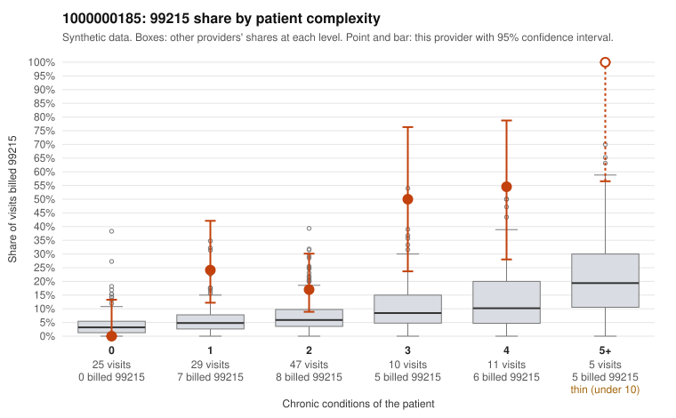

# 1000000185: 1000000185: too few returned records to judge

**Leaning (advisory):** Inconclusive

## Why

1000000185 billed 99215 on 24.4% of 127 claims against an expected 6.1% given patient complexity (risk-adjusted score 3.23; plain z-score vs peers 2.61). 23% of this provider's 99215 claims were on patients with 0 or 1 chronic conditions. Records came back for 30 claims. Of 6 documented 99215 claims, 0 (0%) were documented below the billed level, against 24% for the comparison providers. Note checks on 30 returned notes (share showing each sign): problems 10%, late 3%, unsigned 0%, data 0%. No audit trail was received. 1 of 19 notes claiming moderate-or-higher data reviewed had no lab or test line on the claim. The evidence does not support a call either way yet. Examples: C0092420: billed 99215, patient aged 65 with 1 chronic condition(s) (type 2 diabetes). C0092429: billed 99215, patient aged 27 with 1 chronic condition(s) (obesity).

## Evidence chart

## Cited claims

`C0092420`, `C0092429`

## Suggested next steps

- 30 charts came back but do not settle it: request a targeted sample of 99215 charts, starting with C0092420, C0092429.
- Re-check after the targeted charts arrive; do not call upcoding or a sicker panel on this evidence alone.

---
Citations checked: 2/2 valid. Synthetic data. The leaning is advisory; the flag comes from the statistical screen, and no clinical documentation is available beyond the sampled records-review facts shown in the packet.
