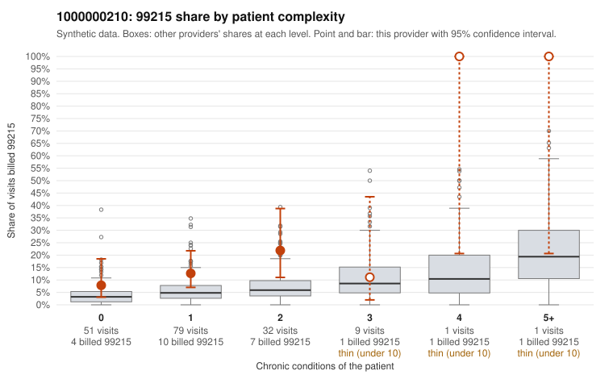

# 1000000210: 1000000210: too few returned records to judge

**Leaning (advisory):** Inconclusive

## Why

1000000210 billed 99215 on 13.9% of 173 claims against an expected 4.5% given patient complexity (risk-adjusted score 2.15; plain z-score vs peers 0.99). 58% of this provider's 99215 claims were on patients with 0 or 1 chronic conditions. Records came back for 43 claims. Of 19 documented 99215 claims, 4 (21%) were documented below the billed level, against 24% for the comparison providers. Note checks on 43 returned notes (share showing each sign): problems 37%, late 7%, unsigned 0%, data 2%, bulk created 0%, paste heavy 0%. 2 of 35 notes claiming moderate-or-higher data reviewed had no lab or test line on the claim. The evidence does not support a call either way yet. Examples: C0103088: billed 99215, patient aged 35 with 1 chronic condition(s) (hyperlipidemia); documented MDM level moderate, 35 minutes. C0103093: billed 99215, patient aged 46 with 1 chronic condition(s) (atrial fibrillation); documented MDM level moderate, 28 minutes. C0103092: billed 99215, patient aged 46 with 1 chronic condition(s) (atrial fibrillation).

## Evidence chart

## Cited claims

`C0103088`, `C0103093`, `C0103092`

## Suggested next steps

- 43 charts came back but do not settle it: request a targeted sample of 99215 charts, starting with C0103088, C0103093, C0103092.
- Re-check after the targeted charts arrive; do not call upcoding or a sicker panel on this evidence alone.

---
Citations checked: 3/3 valid. Synthetic data. The leaning is advisory; the flag comes from the statistical screen, and no clinical documentation is available beyond the sampled records-review facts shown in the packet.
