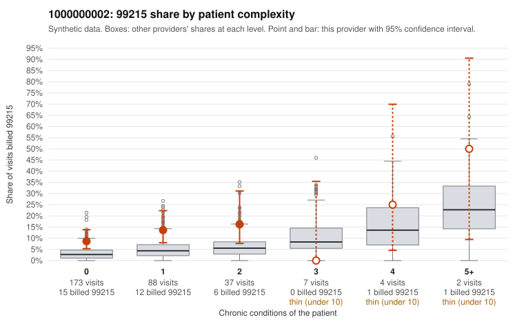

# 1000000002: 1000000002: documented 99215 claims mostly support the level billed (19% below)

**Leaning (advisory):** Pattern consistent with a high-acuity panel

## Why

1000000002 billed 99215 on 11.3% of 311 claims against an expected 3.9% given patient complexity (risk-adjusted score 2.31; plain z-score vs peers 0.55). 77% of this provider's 99215 claims were on patients with 0 or 1 chronic conditions. Records came back for 45 claims. Of 16 documented 99215 claims, 3 (19%) were documented below the billed level, against 27% for the comparison providers. Note checks on 45 returned notes (share showing each sign): problems 49%, late 7%, unsigned 0%, data 4%, bulk created 0%, paste heavy 0%. 2 of 33 notes claiming moderate-or-higher data reviewed had no lab or test line on the claim. This pattern is consistent with a high-acuity panel. The sampled documentation supports the billed level. Examples: C0000223: billed 99215, patient aged 49 with 4 chronic condition(s) (hypothyroidism;type 2 diabetes;hypertension;asthma); documented MDM level high, 53 minutes. C0000242: billed 99215; documented MDM level high, 54 minutes. C0000331: billed 99215, patient aged 85 with 1 chronic condition(s) (hyperlipidemia); documented MDM level high, 46 minutes. C0000338: billed 99215, patient aged 89 with 5 chronic condition(s) (hypothyroidism;type 2 diabetes;depression;atrial fibrillation;COPD).

## Evidence chart

## Cited claims

`C0000223`, `C0000242`, `C0000331`, `C0000338`

## Suggested next steps

- Do not pursue recovery on this evidence: 45 charts came back and they support the level billed (3 of 16 documented 99215 claims below the billed level).
- Revisit if the 99215 share keeps rising against peers or a larger sample shows unsupported claims.

---
Citations checked: 4/4 valid. Synthetic data. The leaning is advisory; the flag comes from the statistical screen, and no clinical documentation is available beyond the sampled records-review facts shown in the packet.
