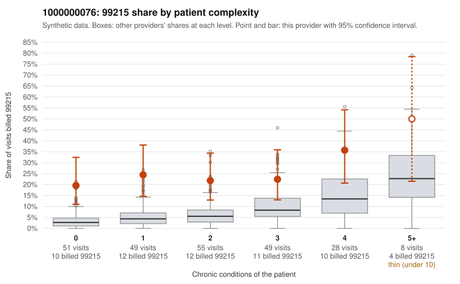

# 1000000076: 1000000076: 11 of 22 documented 99215 claims (50%) are documented below the billed level

**Leaning (advisory):** Pattern consistent with upcoding

## Why

1000000076 billed 99215 on 24.6% of 240 claims against an expected 6.4% given patient complexity (risk-adjusted score 4.07; plain z-score vs peers 2.54). 37% of this provider's 99215 claims were on patients with 0 or 1 chronic conditions. Records came back for 45 claims. Of 22 documented 99215 claims, 11 (50%) were documented below the billed level, against 27% for the comparison providers. Note checks on 45 returned notes (share showing each sign): problems 27%, late 7%, unsigned 0%, data 7%. No audit trail was received. 5 of 35 notes claiming moderate-or-higher data reviewed had no lab or test line on the claim. This pattern is consistent with upcoding. It is a reason to review the records, not a finding. Examples: C0041678: billed 99215, patient aged 63 with 4 chronic condition(s) (hyperlipidemia;hypertension;COPD;osteoarthritis); documented MDM level low, minutes not recorded. C0041703: billed 99215; documented MDM level moderate, minutes not recorded. C0041728: billed 99215, patient aged 18 with 0 chronic condition(s); documented MDM level moderate, 38 minutes. C0041612: billed 99215, patient aged 61 with 1 chronic condition(s) (hyperlipidemia). C0041661: billed 99215, patient aged 60 with 1 chronic condition(s) (depression). C0041690: billed 99215, patient aged 48 with 1 chronic condition(s) (osteoarthritis).

## Evidence chart

## Cited claims

`C0041678`, `C0041703`, `C0041728`, `C0041612`, `C0041661`, `C0041690`

## Suggested next steps

- Request the full charts for C0041678, C0041703, C0041728 and have a certified coder re-score each against the current E/M rules (medical decision making or total time).
- If the re-scoring confirms the pattern, review the random sample in the recovery packet's sampling plan before any overpayment estimate; do not extrapolate from a targeted sample.
- Look at the notes themselves: 27% address fewer problems than their level implies and 7% were signed late; request the audit trail for C0041678, C0041703, C0041728.

---
Citations checked: 6/6 valid. Synthetic data. The leaning is advisory; the flag comes from the statistical screen, and no clinical documentation is available beyond the sampled records-review facts shown in the packet.
