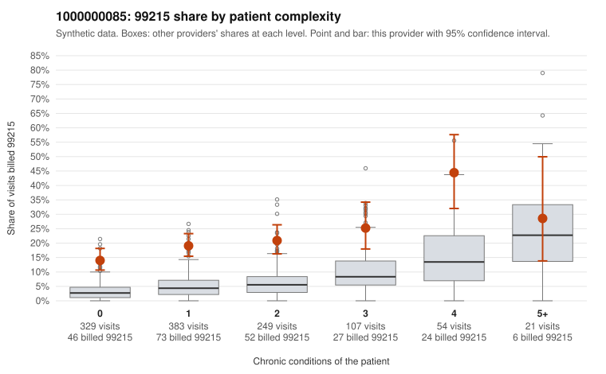

# 1000000085: 1000000085: 2 of 9 documented 99215 claims (22%) are documented below the billed level

**Leaning (advisory):** Pattern consistent with upcoding

## Why

1000000085 billed 99215 on 19.9% of 1,143 claims against an expected 5.1% given patient complexity (risk-adjusted score 8.22; plain z-score vs peers 1.85). 52% of this provider's 99215 claims were on patients with 0 or 1 chronic conditions. Records came back for 30 claims. Of 9 documented 99215 claims, 2 (22%) were documented below the billed level, against 27% for the comparison providers. Note checks on 30 returned notes (share showing each sign): problems 23%, late 13%, unsigned 0%, data 13%, bulk created 13%, paste heavy 17%. 4 of 19 notes claiming moderate-or-higher data reviewed had no lab or test line on the claim. This pattern is consistent with upcoding. It is a reason to review the records, not a finding. Examples: C0045739: billed 99215; documented MDM level moderate, minutes not recorded. C0046244: billed 99215; documented MDM level moderate, 31 minutes. C0045171: billed 99215, patient aged 33 with 1 chronic condition(s) (type 2 diabetes). C0045201: billed 99215, patient aged 63 with 1 chronic condition(s) (hyperlipidemia). C0045222: billed 99215, patient aged 50 with 1 chronic condition(s) (hyperlipidemia).

## Evidence chart

## Cited claims

`C0045739`, `C0046244`, `C0045171`, `C0045201`, `C0045222`

## Suggested next steps

- Request the full charts for C0045739, C0046244, C0045171 and have a certified coder re-score each against the current E/M rules (medical decision making or total time).
- If the re-scoring confirms the pattern, review the random sample in the recovery packet's sampling plan before any overpayment estimate; do not extrapolate from a targeted sample.
- Look at the notes themselves: 23% address fewer problems than their level implies and 13% were signed late; request the audit trail for C0045739, C0046244, C0045171.

---
Citations checked: 5/5 valid. Synthetic data. The leaning is advisory; the flag comes from the statistical screen, and no clinical documentation is available beyond the sampled records-review facts shown in the packet.
