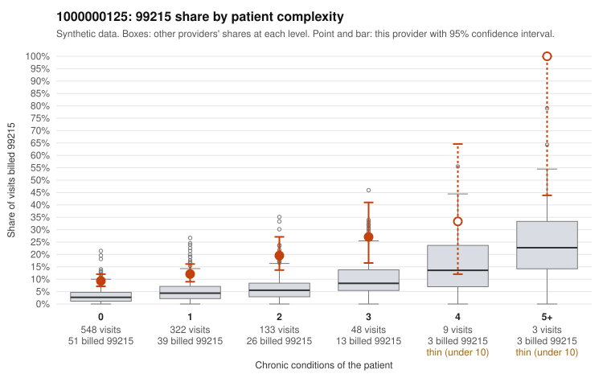

# 1000000125: 1000000125: too few returned records to judge

**Leaning (advisory):** Inconclusive

## Why

1000000125 billed 99215 on 12.7% of 1,063 claims against an expected 3.9% given patient complexity (risk-adjusted score 5.21; plain z-score vs peers 0.77). 67% of this provider's 99215 claims were on patients with 0 or 1 chronic conditions. Records came back for 45 claims. Of 17 documented 99215 claims, 3 (18%) were documented below the billed level, against 27% for the comparison providers. Note checks on 45 returned notes (share showing each sign): problems 36%, late 0%, unsigned 0%, data 4%. No audit trail was received. 2 of 28 notes claiming moderate-or-higher data reviewed had no lab or test line on the claim. The evidence does not support a call either way yet. Examples: C0066660: billed 99215, patient aged 33 with 0 chronic condition(s); documented MDM level moderate, 30 minutes. C0066699: billed 99215; documented MDM level moderate, 33 minutes. C0066412: billed 99215, patient aged 62 with 0 chronic condition(s). C0066469: billed 99215, patient aged 56 with 1 chronic condition(s) (depression).

## Evidence chart

## Cited claims

`C0066660`, `C0066699`, `C0066412`, `C0066469`

## Suggested next steps

- 45 charts came back but do not settle it: request a targeted sample of 99215 charts, starting with C0066660, C0066699, C0066412.
- Re-check after the targeted charts arrive; do not call upcoding or a sicker panel on this evidence alone.

---
Citations checked: 4/4 valid. Synthetic data. The leaning is advisory; the flag comes from the statistical screen, and no clinical documentation is available beyond the sampled records-review facts shown in the packet.
