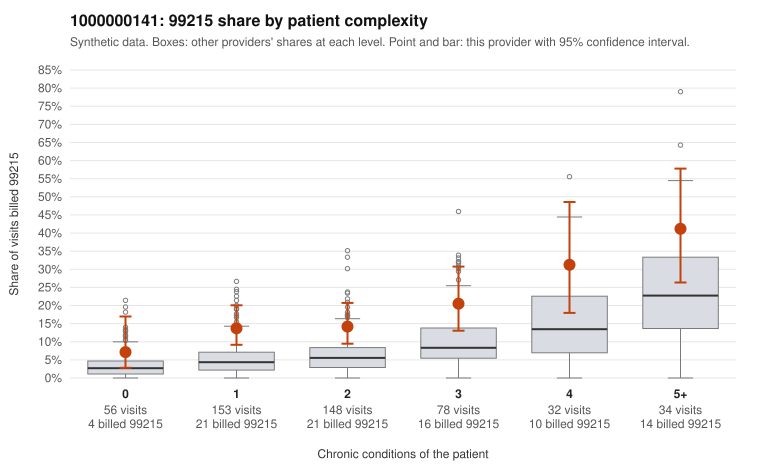

# 1000000141: 1000000141: documented 99215 claims mostly support the level billed (17% below)

**Leaning (advisory):** Pattern consistent with a high-acuity panel

## Why

1000000141 billed 99215 on 17.2% of 501 claims against an expected 6.6% given patient complexity (risk-adjusted score 3.37; plain z-score vs peers 1.43). 29% of this provider's 99215 claims were on patients with 0 or 1 chronic conditions. Records came back for 30 claims. Of 6 documented 99215 claims, 1 (17%) were documented below the billed level, against 27% for the comparison providers. Note checks on 30 returned notes (share showing each sign): problems 27%, late 0%, unsigned 0%, data 10%. No audit trail was received. 4 of 21 notes claiming moderate-or-higher data reviewed had no lab or test line on the claim. This pattern is consistent with a high-acuity panel. The sampled documentation supports the billed level. Examples: C0074445: billed 99215; documented MDM level high, minutes not recorded. C0074553: billed 99215; documented MDM level high, 50 minutes. C0074660: billed 99215; documented MDM level high, 53 minutes. C0074344: billed 99215, patient aged 84 with 4 chronic condition(s) (type 2 diabetes;obesity;atrial fibrillation;chronic kidney disease). C0074431: billed 99215, patient aged 44 with 4 chronic condition(s) (obesity;depression;hypertension;atrial fibrillation).

## Evidence chart

## Cited claims

`C0074445`, `C0074553`, `C0074660`, `C0074344`, `C0074431`

## Suggested next steps

- Do not pursue recovery on this evidence: 30 charts came back and they support the level billed (1 of 6 documented 99215 claims below the billed level).
- Revisit if the 99215 share keeps rising against peers or a larger sample shows unsupported claims.

---
Citations checked: 5/5 valid. Synthetic data. The leaning is advisory; the flag comes from the statistical screen, and no clinical documentation is available beyond the sampled records-review facts shown in the packet.
