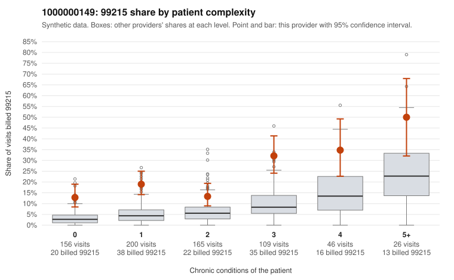

# 1000000149: 1000000149: too few returned records to judge

**Leaning (advisory):** Inconclusive

## Why

1000000149 billed 99215 on 20.5% of 702 claims against an expected 5.9% given patient complexity (risk-adjusted score 5.91; plain z-score vs peers 1.93). 40% of this provider's 99215 claims were on patients with 0 or 1 chronic conditions. Records came back for 45 claims. Of 18 documented 99215 claims, 2 (11%) were documented below the billed level, against 27% for the comparison providers. Note checks on 45 returned notes (share showing each sign): problems 20%, late 9%, unsigned 0%, data 0%. No audit trail was received. 1 of 33 notes claiming moderate-or-higher data reviewed had no lab or test line on the claim. The evidence does not support a call either way yet. Examples: C0080165: billed 99215; documented MDM level moderate, 32 minutes. C0080260: billed 99215, patient aged 55 with 0 chronic condition(s); documented MDM level low, 22 minutes. C0080173: billed 99215, patient aged 47 with 0 chronic condition(s). C0080183: billed 99215, patient aged 70 with 0 chronic condition(s).

## Evidence chart

## Cited claims

`C0080165`, `C0080260`, `C0080173`, `C0080183`

## Suggested next steps

- 45 charts came back but do not settle it: request a targeted sample of 99215 charts, starting with C0080165, C0080260, C0080173.
- Re-check after the targeted charts arrive; do not call upcoding or a sicker panel on this evidence alone.

---
Citations checked: 4/4 valid. Synthetic data. The leaning is advisory; the flag comes from the statistical screen, and no clinical documentation is available beyond the sampled records-review facts shown in the packet.
