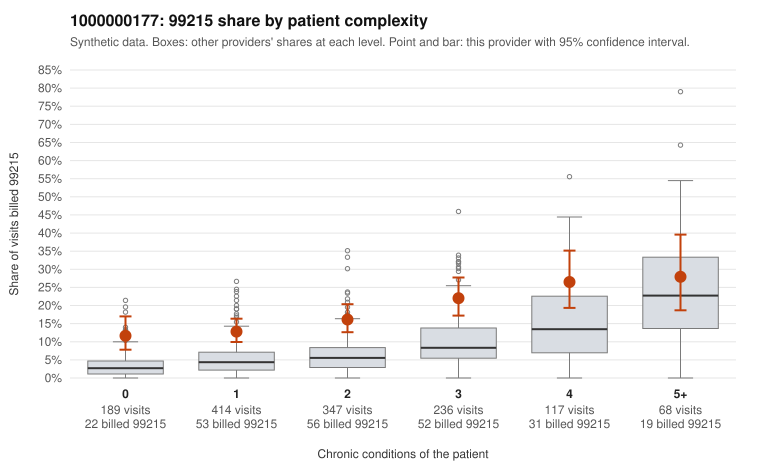

# 1000000177: 1000000177: 6 of 18 documented 99214 and 99215 claims (33%) are documented below the billed level

**Leaning (advisory):** Pattern consistent with upcoding

## Why

1000000177 billed 99215 on 17.0% of 1,371 claims against an expected 6.4% given patient complexity (risk-adjusted score 5.70; plain z-score vs peers 1.41). 32% of this provider's 99215 claims were on patients with 0 or 1 chronic conditions. Records came back for 27 claims. Of 5 documented 99215 claims, 4 (80%) were documented below the billed level, against 27% for the comparison providers. Note checks on 27 returned notes (share showing each sign): problems 22%, late 7%, unsigned 0%, data 4%. No audit trail was received. 2 of 16 notes claiming moderate-or-higher data reviewed had no lab or test line on the claim. This pattern is consistent with upcoding. It is a reason to review the records, not a finding. Examples: C0096836: billed 99215; documented MDM level moderate, minutes not recorded. C0097373: billed 99215; documented MDM level moderate, 33 minutes. C0097628: billed 99215; documented MDM level moderate, minutes not recorded. C0096543: billed 99215, patient aged 31 with 0 chronic condition(s). C0096576: billed 99215, patient aged 61 with 1 chronic condition(s) (atrial fibrillation). C0096602: billed 99215, patient aged 40 with 1 chronic condition(s) (hypertension).

## Evidence chart

## Cited claims

`C0096836`, `C0097373`, `C0097628`, `C0096543`, `C0096576`, `C0096602`

## Suggested next steps

- Request the full charts for C0096836, C0097373, C0097628 and have a certified coder re-score each against the current E/M rules (medical decision making or total time).
- If the re-scoring confirms the pattern, review the random sample in the recovery packet's sampling plan before any overpayment estimate; do not extrapolate from a targeted sample.
- Look at the notes themselves: 22% address fewer problems than their level implies and 7% were signed late; request the audit trail for C0096836, C0097373, C0097628.

---
Citations checked: 6/6 valid. Synthetic data. The leaning is advisory; the flag comes from the statistical screen, and no clinical documentation is available beyond the sampled records-review facts shown in the packet.
