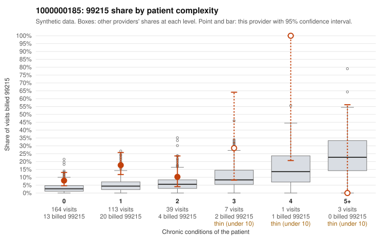

# 1000000185: 1000000185: too few returned records to judge

**Leaning (advisory):** Inconclusive

## Why

1000000185 billed 99215 on 12.2% of 327 claims against an expected 3.9% given patient complexity (risk-adjusted score 2.68; plain z-score vs peers 0.70). 82% of this provider's 99215 claims were on patients with 0 or 1 chronic conditions. Records came back for 30 claims. Of 6 documented 99215 claims, 1 (17%) were documented below the billed level, against 27% for the comparison providers. Note checks on 30 returned notes (share showing each sign): problems 40%, late 0%, unsigned 0%, data 0%, bulk created 0%, paste heavy 0%. 0 of 15 notes claiming moderate-or-higher data reviewed had no lab or test line on the claim. The evidence does not support a call either way yet. Examples: C0102601: billed 99215, patient aged 47 with 0 chronic condition(s); documented MDM level moderate, minutes not recorded. C0102422: billed 99215, patient aged 61 with 1 chronic condition(s) (hypertension). C0102467: billed 99215, patient aged 36 with 0 chronic condition(s).

## Evidence chart

## Cited claims

`C0102601`, `C0102422`, `C0102467`

## Suggested next steps

- 30 charts came back but do not settle it: request a targeted sample of 99215 charts, starting with C0102601, C0102422, C0102467.
- Re-check after the targeted charts arrive; do not call upcoding or a sicker panel on this evidence alone.

---
Citations checked: 3/3 valid. Synthetic data. The leaning is advisory; the flag comes from the statistical screen, and no clinical documentation is available beyond the sampled records-review facts shown in the packet.
