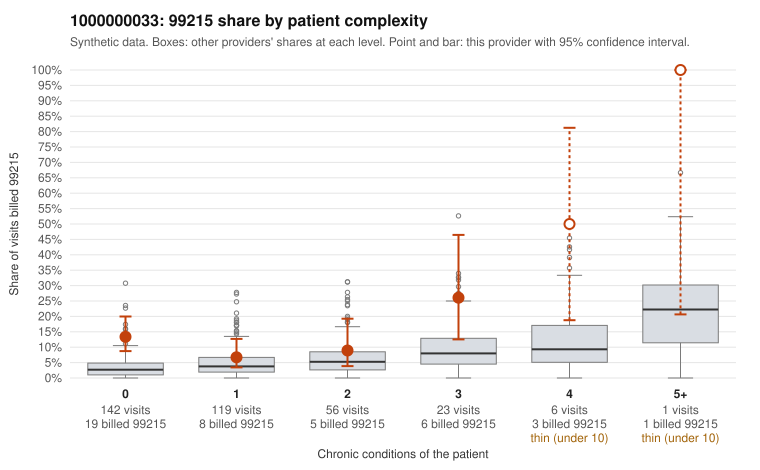

# 1000000033: 1000000033: 0 of 20 documented 99215 claims (0%) are documented below the billed level

**Leaning (advisory):** Pattern consistent with upcoding

## Why

1000000033 billed 99215 on 12.1% of 347 claims against an expected 3.9% given patient complexity (risk-adjusted score 3.47; plain z-score vs peers 0.96). 64% of this provider's 99215 claims were on patients with 0 or 1 chronic conditions. Records came back for 45 claims. Of 20 documented 99215 claims, 0 (0%) were documented below the billed level, against 42% for the comparison providers. Note checks on 45 returned notes (share showing each sign): problems 38%, late 29%, unsigned 0%, data 13%, bulk created 7%, paste heavy 7%. 6 of 33 notes claiming moderate-or-higher data reviewed had no lab or test line on the claim. This pattern is consistent with upcoding. It is a reason to review the records, not a finding. Examples: C0016852: billed 99213; documented MDM level straightforward, minutes not recorded. C0016720: billed 99215, patient aged 57 with 0 chronic condition(s). C0016728: billed 99215, patient aged 57 with 1 chronic condition(s) (atrial fibrillation). C0016736: billed 99215, patient aged 70 with 1 chronic condition(s) (type 2 diabetes).

## Evidence chart

## Cited claims

`C0016852`, `C0016720`, `C0016728`, `C0016736`

## Suggested next steps

- Request the full charts for C0016852, C0016720, C0016728 and have a certified coder re-score each against the current E/M rules (medical decision making or total time).
- If the re-scoring confirms the pattern, review the random sample in the recovery packet's sampling plan before any overpayment estimate; do not extrapolate from a targeted sample.
- Look at the notes themselves: 38% address fewer problems than their level implies and 29% were signed late; request the audit trail for C0016852, C0016720, C0016728.

---
Citations checked: 4/4 valid. Synthetic data. The leaning is advisory; the flag comes from the statistical screen, and no clinical documentation is available beyond the sampled records-review facts shown in the packet.
