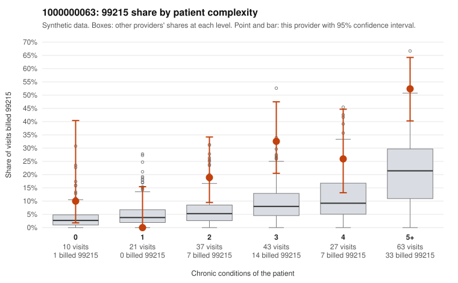

# 1000000063: 1000000063: documented 99215 claims mostly support the level billed (0% below)

**Leaning (advisory):** Pattern consistent with a high-acuity panel

## Why

1000000063 billed 99215 on 30.8% of 201 claims against an expected 10.8% given patient complexity (risk-adjusted score 4.08; plain z-score vs peers 4.29). 2% of this provider's 99215 claims were on patients with 0 or 1 chronic conditions. Records came back for 30 claims. Of 9 documented 99215 claims, 0 (0%) were documented below the billed level, against 42% for the comparison providers. Note checks on 30 returned notes (share showing each sign): problems 3%, late 10%, unsigned 0%, data 7%. No audit trail was received. 3 of 25 notes claiming moderate-or-higher data reviewed had no lab or test line on the claim. This pattern is consistent with a high-acuity panel. The sampled documentation supports the billed level. Examples: C0030652: billed 99215; documented MDM level high, minutes not recorded. C0030654: billed 99215, patient aged 74 with 5 chronic condition(s) (type 2 diabetes;hyperlipidemia;depression;hypertension;atrial fibrillation); documented MDM level high, 46 minutes. C0030664: billed 99215; documented MDM level high, 46 minutes. C0030563: billed 99215, patient aged 62 with 4 chronic condition(s) (hypothyroidism;type 2 diabetes;obesity;atrial fibrillation). C0030575: billed 99215, patient aged 72 with 5 chronic condition(s) (type 2 diabetes;obesity;hypertension;heart failure;asthma).

## Evidence chart

## Cited claims

`C0030652`, `C0030654`, `C0030664`, `C0030563`, `C0030575`

## Suggested next steps

- Do not pursue recovery on this evidence: 30 charts came back and they support the level billed (0 of 9 documented 99215 claims below the billed level).
- Revisit if the 99215 share keeps rising against peers or a larger sample shows unsupported claims.

---
Citations checked: 5/5 valid. Synthetic data. The leaning is advisory; the flag comes from the statistical screen, and no clinical documentation is available beyond the sampled records-review facts shown in the packet.
