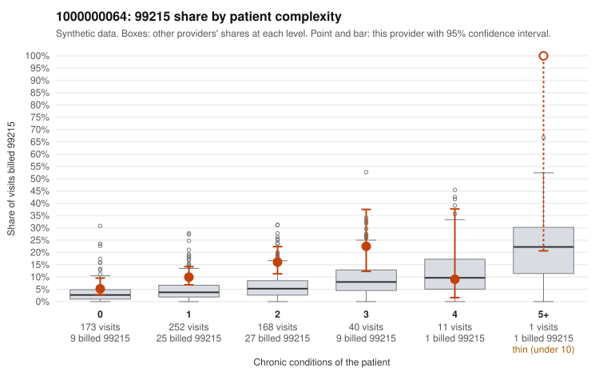

# 1000000064: 1000000064: too few returned records to judge

**Leaning (advisory):** Inconclusive

## Why

1000000064 billed 99215 on 11.2% of 645 claims against an expected 4.2% given patient complexity (risk-adjusted score 3.86; plain z-score vs peers 0.79). 47% of this provider's 99215 claims were on patients with 0 or 1 chronic conditions. Records came back for 30 claims. Of 4 documented 99215 claims, 1 (25%) were documented below the billed level, against 42% for the comparison providers. Note checks on 30 returned notes (share showing each sign): problems 30%, late 7%, unsigned 0%, data 0%. No audit trail was received. 0 of 22 notes claiming moderate-or-higher data reviewed had no lab or test line on the claim. The evidence does not support a call either way yet. Examples: C0030874: billed 99215; documented MDM level moderate, 31 minutes. C0030780: billed 99215, patient aged 40 with 1 chronic condition(s) (hypothyroidism). C0030789: billed 99215, patient aged 50 with 1 chronic condition(s) (type 2 diabetes).

## Evidence chart

## Cited claims

`C0030874`, `C0030780`, `C0030789`

## Suggested next steps

- 30 charts came back but do not settle it: request a targeted sample of 99215 charts, starting with C0030874, C0030780, C0030789.
- Re-check after the targeted charts arrive; do not call upcoding or a sicker panel on this evidence alone.

---
Citations checked: 3/3 valid. Synthetic data. The leaning is advisory; the flag comes from the statistical screen, and no clinical documentation is available beyond the sampled records-review facts shown in the packet.
