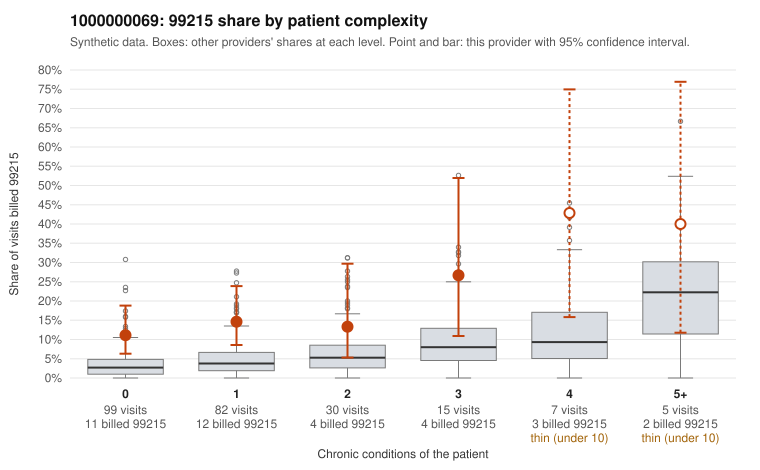

# 1000000069: 1000000069: too few returned records to judge

**Leaning (advisory):** Inconclusive

## Why

1000000069 billed 99215 on 15.1% of 238 claims against an expected 4.2% given patient complexity (risk-adjusted score 3.72; plain z-score vs peers 1.50). 64% of this provider's 99215 claims were on patients with 0 or 1 chronic conditions. Records came back for 30 claims. Of 5 documented 99215 claims, 0 (0%) were documented below the billed level, against 42% for the comparison providers. Note checks on 30 returned notes (share showing each sign): problems 27%, late 10%, unsigned 0%, data 3%. No audit trail was received. 1 of 20 notes claiming moderate-or-higher data reviewed had no lab or test line on the claim. The evidence does not support a call either way yet. Examples: C0032095: billed 99213; documented MDM level straightforward, minutes not recorded. C0032252: billed 99213; documented MDM level straightforward, minutes not recorded. C0032072: billed 99215, patient aged 40 with 0 chronic condition(s). C0032075: billed 99215, patient aged 90 with 0 chronic condition(s); documented MDM level high, 52 minutes.

## Evidence chart

## Cited claims

`C0032095`, `C0032252`, `C0032072`, `C0032075`

## Suggested next steps

- 30 charts came back but do not settle it: request a targeted sample of 99215 charts, starting with C0032095, C0032252, C0032072.
- Re-check after the targeted charts arrive; do not call upcoding or a sicker panel on this evidence alone.

---
Citations checked: 4/4 valid. Synthetic data. The leaning is advisory; the flag comes from the statistical screen, and no clinical documentation is available beyond the sampled records-review facts shown in the packet.
