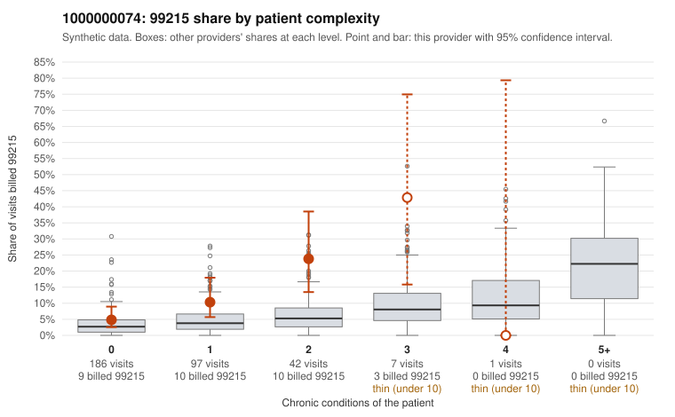

# 1000000074: 1000000074: too few returned records to judge

**Leaning (advisory):** Inconclusive

## Why

1000000074 billed 99215 on 9.6% of 333 claims against an expected 3.3% given patient complexity (risk-adjusted score 2.81; plain z-score vs peers 0.51). 59% of this provider's 99215 claims were on patients with 0 or 1 chronic conditions. Records came back for 45 claims. Of 17 documented 99215 claims, 5 (29%) were documented below the billed level, against 42% for the comparison providers. Note checks on 45 returned notes (share showing each sign): problems 40%, late 2%, unsigned 0%, data 9%, bulk created 0%, paste heavy 2%. 6 of 30 notes claiming moderate-or-higher data reviewed had no lab or test line on the claim. The evidence does not support a call either way yet. Examples: C0033737: billed 99215, patient aged 49 with 0 chronic condition(s); documented MDM level moderate, 35 minutes. C0033742: billed 99215, patient aged 56 with 1 chronic condition(s) (hyperlipidemia); documented MDM level moderate, 35 minutes. C0033683: billed 99215, patient aged 53 with 0 chronic condition(s). C0033732: billed 99215, patient aged 67 with 1 chronic condition(s) (hypothyroidism).

## Evidence chart

## Cited claims

`C0033737`, `C0033742`, `C0033683`, `C0033732`

## Suggested next steps

- 45 charts came back but do not settle it: request a targeted sample of 99215 charts, starting with C0033737, C0033742, C0033683.
- Re-check after the targeted charts arrive; do not call upcoding or a sicker panel on this evidence alone.

---
Citations checked: 4/4 valid. Synthetic data. The leaning is advisory; the flag comes from the statistical screen, and no clinical documentation is available beyond the sampled records-review facts shown in the packet.
