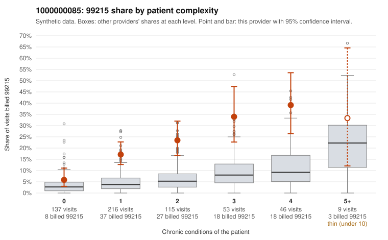

# 1000000085: 1000000085: too few returned records to judge

**Leaning (advisory):** Inconclusive

## Why

1000000085 billed 99215 on 19.3% of 576 claims against an expected 4.9% given patient complexity (risk-adjusted score 7.04; plain z-score vs peers 2.23). 41% of this provider's 99215 claims were on patients with 0 or 1 chronic conditions. Records came back for 30 claims. Of 8 documented 99215 claims, 2 (25%) were documented below the billed level, against 42% for the comparison providers. Note checks on 30 returned notes (share showing each sign): problems 27%, late 3%, unsigned 0%, data 7%. No audit trail was received. 4 of 20 notes claiming moderate-or-higher data reviewed had no lab or test line on the claim. The evidence does not support a call either way yet. Examples: C0037269: billed 99215, patient aged 18 with 1 chronic condition(s) (hypertension); documented MDM level moderate, minutes not recorded. C0037401: billed 99215, patient aged 95 with 5 chronic condition(s) (type 2 diabetes;depression;hypertension;osteoarthritis;chronic kidney disease); documented MDM level moderate, minutes not recorded. C0036950: billed 99215, patient aged 67 with 0 chronic condition(s). C0036961: billed 99215, patient aged 18 with 1 chronic condition(s) (type 2 diabetes).

## Evidence chart

## Cited claims

`C0037269`, `C0037401`, `C0036950`, `C0036961`

## Suggested next steps

- 30 charts came back but do not settle it: request a targeted sample of 99215 charts, starting with C0037269, C0037401, C0036950.
- Re-check after the targeted charts arrive; do not call upcoding or a sicker panel on this evidence alone.

---
Citations checked: 4/4 valid. Synthetic data. The leaning is advisory; the flag comes from the statistical screen, and no clinical documentation is available beyond the sampled records-review facts shown in the packet.
