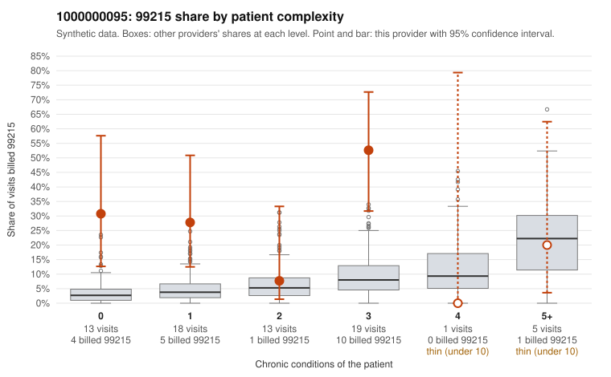

# 1000000095: 1000000095: too few returned records to judge

**Leaning (advisory):** Inconclusive

## Why

1000000095 billed 99215 on 30.4% of 69 claims against an expected 6.2% given patient complexity (risk-adjusted score 3.70; plain z-score vs peers 4.22). 43% of this provider's 99215 claims were on patients with 0 or 1 chronic conditions. Records came back for 12 claims. Of 4 documented 99215 claims, 1 (25%) were documented below the billed level, against 42% for the comparison providers. Note checks on 12 returned notes (share showing each sign): problems 17%, late 0%, unsigned 0%, data 0%. No audit trail was received. 0 of 8 notes claiming moderate-or-higher data reviewed had no lab or test line on the claim. The evidence does not support a call either way yet. Examples: C0042429: billed 99215; documented MDM level low, minutes not recorded. C0042394: billed 99215, patient aged 45 with 1 chronic condition(s) (obesity); documented MDM level high, minutes not recorded. C0042396: billed 99215, patient aged 30 with 1 chronic condition(s) (asthma).

## Evidence chart

## Cited claims

`C0042429`, `C0042394`, `C0042396`

## Suggested next steps

- 12 charts came back but do not settle it: request a targeted sample of 99215 charts, starting with C0042429, C0042394, C0042396.
- Re-check after the targeted charts arrive; do not call upcoding or a sicker panel on this evidence alone.

---
Citations checked: 3/3 valid. Synthetic data. The leaning is advisory; the flag comes from the statistical screen, and no clinical documentation is available beyond the sampled records-review facts shown in the packet.
