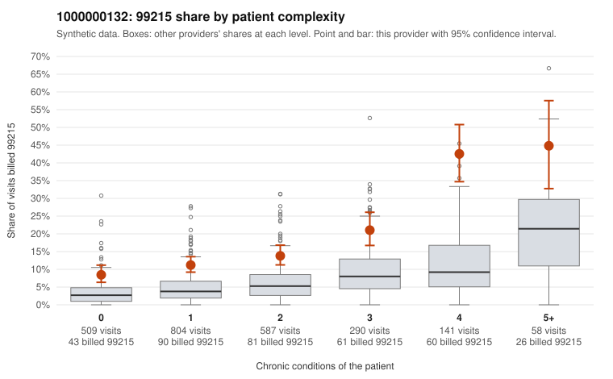

# 1000000132: 1000000132: documented 99215 claims mostly support the level billed (14% below)

**Leaning (advisory):** Pattern consistent with a high-acuity panel

## Why

1000000132 billed 99215 on 15.1% of 2,389 claims against an expected 5.1% given patient complexity (risk-adjusted score 9.77; plain z-score vs peers 1.49). 37% of this provider's 99215 claims were on patients with 0 or 1 chronic conditions. Records came back for 30 claims. Of 7 documented 99215 claims, 1 (14%) were documented below the billed level, against 42% for the comparison providers. Note checks on 30 returned notes (share showing each sign): problems 23%, late 3%, unsigned 0%, data 3%. No audit trail was received. 1 of 22 notes claiming moderate-or-higher data reviewed had no lab or test line on the claim. This pattern is consistent with a high-acuity panel. The sampled documentation supports the billed level. Examples: C0063873: billed 99215, patient aged 49 with 5 chronic condition(s) (type 2 diabetes;obesity;hyperlipidemia;hypertension;chronic kidney disease); documented MDM level high, 45 minutes. C0064010: billed 99215; documented MDM level high, minutes not recorded. C0064905: billed 99215; documented MDM level high, minutes not recorded. C0063259: billed 99215, patient aged 60 with 4 chronic condition(s) (obesity;hyperlipidemia;COPD;osteoarthritis). C0063869: billed 99215, patient aged 50 with 5 chronic condition(s) (type 2 diabetes;hyperlipidemia;hypertension;atrial fibrillation;COPD).

## Evidence chart

## Cited claims

`C0063873`, `C0064010`, `C0064905`, `C0063259`, `C0063869`

## Suggested next steps

- Do not pursue recovery on this evidence: 30 charts came back and they support the level billed (1 of 7 documented 99215 claims below the billed level).
- Revisit if the 99215 share keeps rising against peers or a larger sample shows unsupported claims.

---
Citations checked: 5/5 valid. Synthetic data. The leaning is advisory; the flag comes from the statistical screen, and no clinical documentation is available beyond the sampled records-review facts shown in the packet.
