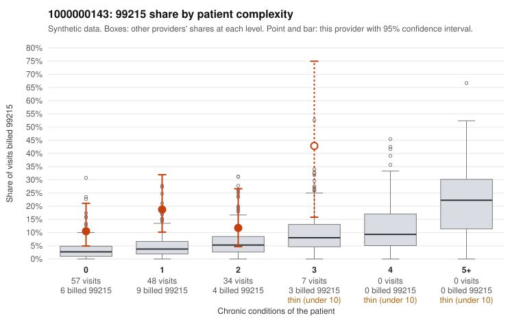

# 1000000143: 1000000143: too few returned records to judge

**Leaning (advisory):** Inconclusive

## Why

1000000143 billed 99215 on 15.1% of 146 claims against an expected 3.8% given patient complexity (risk-adjusted score 3.12; plain z-score vs peers 1.49). 68% of this provider's 99215 claims were on patients with 0 or 1 chronic conditions. Records came back for 30 claims. Of 5 documented 99215 claims, 0 (0%) were documented below the billed level, against 42% for the comparison providers. Note checks on 30 returned notes (share showing each sign): problems 23%, late 10%, unsigned 0%, data 0%. No audit trail was received. 0 of 21 notes claiming moderate-or-higher data reviewed had no lab or test line on the claim. The evidence does not support a call either way yet. Examples: C0069142: billed 99214; documented MDM level low, minutes not recorded. C0069183: billed 99213; documented MDM level straightforward, minutes not recorded. C0069136: billed 99215, patient aged 53 with 1 chronic condition(s) (hyperlipidemia). C0069165: billed 99215, patient aged 44 with 1 chronic condition(s) (hypothyroidism).

## Evidence chart

## Cited claims

`C0069142`, `C0069183`, `C0069136`, `C0069165`

## Suggested next steps

- 30 charts came back but do not settle it: request a targeted sample of 99215 charts, starting with C0069142, C0069183, C0069136.
- Re-check after the targeted charts arrive; do not call upcoding or a sicker panel on this evidence alone.

---
Citations checked: 4/4 valid. Synthetic data. The leaning is advisory; the flag comes from the statistical screen, and no clinical documentation is available beyond the sampled records-review facts shown in the packet.
