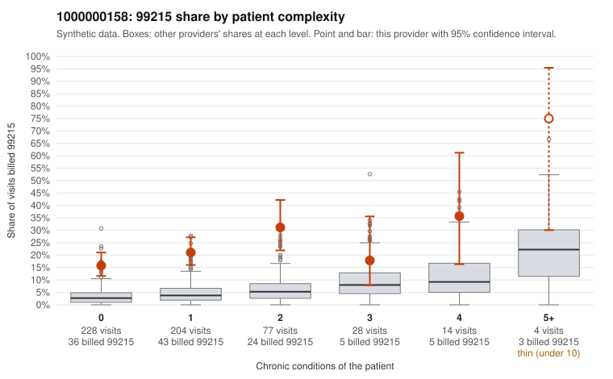

# 1000000158: 1000000158: 0 of 6 documented 99215 claims (0%) are documented below the billed level

**Leaning (advisory):** Pattern consistent with upcoding

## Why

1000000158 billed 99215 on 20.9% of 555 claims against an expected 3.9% given patient complexity (risk-adjusted score 9.10; plain z-score vs peers 2.52). 68% of this provider's 99215 claims were on patients with 0 or 1 chronic conditions. Records came back for 30 claims. Of 6 documented 99215 claims, 0 (0%) were documented below the billed level, against 42% for the comparison providers. Note checks on 30 returned notes (share showing each sign): problems 37%, late 13%, unsigned 0%, data 10%, bulk created 7%, paste heavy 10%. 4 of 19 notes claiming moderate-or-higher data reviewed had no lab or test line on the claim. This pattern is consistent with upcoding. It is a reason to review the records, not a finding. Examples: C0073923: billed 99213; documented MDM level straightforward, minutes not recorded. C0073732: billed 99215, patient aged 42 with 0 chronic condition(s). C0073733: billed 99215, patient aged 51 with 1 chronic condition(s) (heart failure). C0073750: billed 99215, patient aged 37 with 1 chronic condition(s) (depression).

## Evidence chart

## Cited claims

`C0073923`, `C0073732`, `C0073733`, `C0073750`

## Suggested next steps

- Request the full charts for C0073923, C0073732, C0073733 and have a certified coder re-score each against the current E/M rules (medical decision making or total time).
- If the re-scoring confirms the pattern, review the random sample in the recovery packet's sampling plan before any overpayment estimate; do not extrapolate from a targeted sample.
- Look at the notes themselves: 37% address fewer problems than their level implies and 13% were signed late; request the audit trail for C0073923, C0073732, C0073733.

---
Citations checked: 4/4 valid. Synthetic data. The leaning is advisory; the flag comes from the statistical screen, and no clinical documentation is available beyond the sampled records-review facts shown in the packet.
