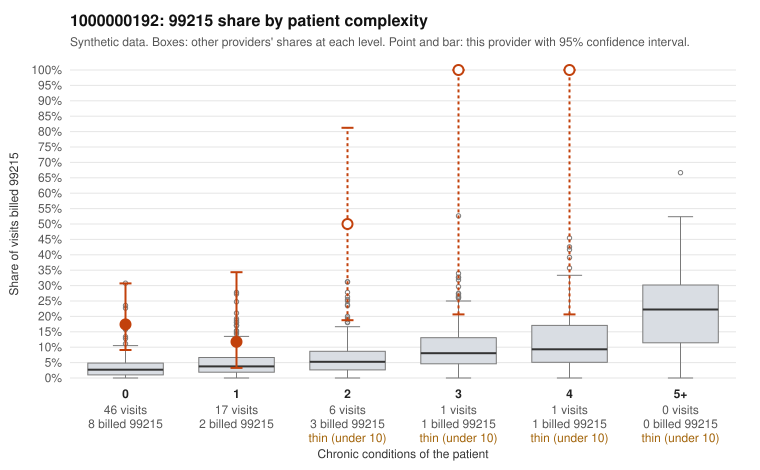

# 1000000192: 1000000192: too few returned records to judge

**Leaning (advisory):** Inconclusive

## Why

1000000192 billed 99215 on 21.1% of 71 claims against an expected 3.1% given patient complexity (risk-adjusted score 3.79; plain z-score vs peers 2.56). 67% of this provider's 99215 claims were on patients with 0 or 1 chronic conditions. Records came back for 30 claims. Of 6 documented 99215 claims, 1 (17%) were documented below the billed level, against 42% for the comparison providers. Note checks on 30 returned notes (share showing each sign): problems 57%, late 3%, unsigned 0%, data 3%, bulk created 0%, paste heavy 0%. 2 of 21 notes claiming moderate-or-higher data reviewed had no lab or test line on the claim. The evidence does not support a call either way yet. Examples: C0086371: billed 99215, patient aged 66 with 0 chronic condition(s); documented MDM level moderate, 37 minutes. C0086299: billed 99215, patient aged 66 with 1 chronic condition(s) (COPD). C0086312: billed 99215, patient aged 58 with 0 chronic condition(s).

## Evidence chart

## Cited claims

`C0086371`, `C0086299`, `C0086312`

## Suggested next steps

- 30 charts came back but do not settle it: request a targeted sample of 99215 charts, starting with C0086371, C0086299, C0086312.
- Re-check after the targeted charts arrive; do not call upcoding or a sicker panel on this evidence alone.

---
Citations checked: 3/3 valid. Synthetic data. The leaning is advisory; the flag comes from the statistical screen, and no clinical documentation is available beyond the sampled records-review facts shown in the packet.
