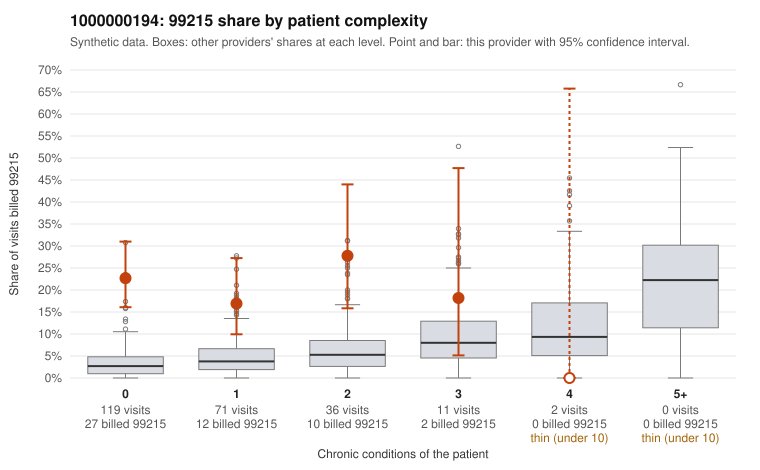

# 1000000194: 1000000194: too few returned records to judge

**Leaning (advisory):** Inconclusive

## Why

1000000194 billed 99215 on 21.3% of 239 claims against an expected 3.6% given patient complexity (risk-adjusted score 6.51; plain z-score vs peers 2.60). 76% of this provider's 99215 claims were on patients with 0 or 1 chronic conditions. Records came back for 29 claims. Of 10 documented 99215 claims, 7 (70%) were documented below the billed level, against 42% for the comparison providers. Note checks on 29 returned notes (share showing each sign): problems 45%, late 7%, unsigned 0%, data 3%, bulk created 0%, paste heavy 0%. 1 of 18 notes claiming moderate-or-higher data reviewed had no lab or test line on the claim. The evidence does not support a call either way yet. Examples: C0087291: billed 99215, patient aged 51 with 0 chronic condition(s); documented MDM level moderate, minutes not recorded. C0087323: billed 99215; documented MDM level low, minutes not recorded. C0087160: billed 99215, patient aged 44 with 0 chronic condition(s). C0087167: billed 99215, patient aged 63 with 0 chronic condition(s).

## Evidence chart

## Cited claims

`C0087291`, `C0087323`, `C0087160`, `C0087167`

## Suggested next steps

- 29 charts came back but do not settle it: request a targeted sample of 99215 charts, starting with C0087291, C0087323, C0087160.
- Re-check after the targeted charts arrive; do not call upcoding or a sicker panel on this evidence alone.

---
Citations checked: 4/4 valid. Synthetic data. The leaning is advisory; the flag comes from the statistical screen, and no clinical documentation is available beyond the sampled records-review facts shown in the packet.
