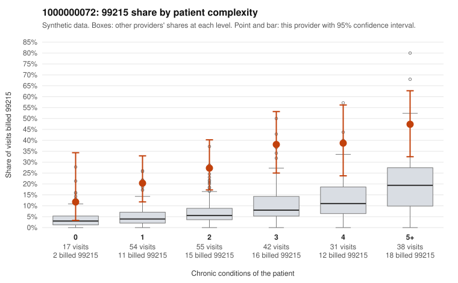

# 1000000072: 1000000072: 0 of 13 documented 99215 claims (0%) are documented below the billed level

**Leaning (advisory):** Pattern consistent with upcoding

## Why

1000000072 billed 99215 on 31.2% of 237 claims against an expected 7.6% given patient complexity (risk-adjusted score 5.70; plain z-score vs peers 4.63). 18% of this provider's 99215 claims were on patients with 0 or 1 chronic conditions. Records came back for 30 claims. Of 13 documented 99215 claims, 0 (0%) were documented below the billed level, against 42% for the comparison providers. Note checks on 30 returned notes (share showing each sign): problems 23%, late 27%, unsigned 0%, data 23%, bulk created 23%, paste heavy 17%. 7 of 22 notes claiming moderate-or-higher data reviewed had no lab or test line on the claim. This pattern is consistent with upcoding. It is a reason to review the records, not a finding. Examples: C0036365: billed 99215, patient aged 34 with 1 chronic condition(s) (osteoarthritis). C0036373: billed 99215, patient aged 26 with 0 chronic condition(s). C0036387: billed 99215, patient aged 41 with 0 chronic condition(s).

## Evidence chart

## Cited claims

`C0036365`, `C0036373`, `C0036387`

## Suggested next steps

- Request the full charts for C0036365, C0036373, C0036387 and have a certified coder re-score each against the current E/M rules (medical decision making or total time).
- If the re-scoring confirms the pattern, review the random sample in the recovery packet's sampling plan before any overpayment estimate; do not extrapolate from a targeted sample.
- Look at the notes themselves: 23% address fewer problems than their level implies and 27% were signed late; request the audit trail for C0036365, C0036373, C0036387.

---
Citations checked: 3/3 valid. Synthetic data. The leaning is advisory; the flag comes from the statistical screen, and no clinical documentation is available beyond the sampled records-review facts shown in the packet.
