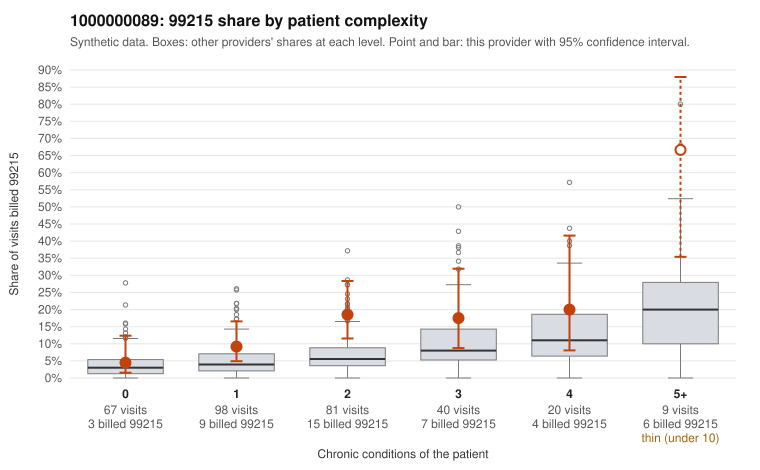

# 1000000089: 1000000089: too few returned records to judge

**Leaning (advisory):** Inconclusive

## Why

1000000089 billed 99215 on 14.0% of 315 claims against an expected 5.3% given patient complexity (risk-adjusted score 2.79; plain z-score vs peers 1.38). 27% of this provider's 99215 claims were on patients with 0 or 1 chronic conditions. Records came back for 29 claims. Of 3 documented 99215 claims, 0 (0%) were documented below the billed level, against 42% for the comparison providers. Note checks on 29 returned notes (share showing each sign): problems 28%, late 3%, unsigned 0%, data 0%. No audit trail was received. 1 of 20 notes claiming moderate-or-higher data reviewed had no lab or test line on the claim. The evidence does not support a call either way yet. Examples: C0047510: billed 99214; documented MDM level low, minutes not recorded. C0047585: billed 99214; documented MDM level low, minutes not recorded. C0047438: billed 99215, patient aged 71 with 1 chronic condition(s) (hypertension). C0047470: billed 99215, patient aged 64 with 1 chronic condition(s) (chronic kidney disease).

## Evidence chart

## Cited claims

`C0047510`, `C0047585`, `C0047438`, `C0047470`

## Suggested next steps

- 29 charts came back but do not settle it: request a targeted sample of 99215 charts, starting with C0047510, C0047585, C0047438.
- Re-check after the targeted charts arrive; do not call upcoding or a sicker panel on this evidence alone.

---
Citations checked: 4/4 valid. Synthetic data. The leaning is advisory; the flag comes from the statistical screen, and no clinical documentation is available beyond the sampled records-review facts shown in the packet.
