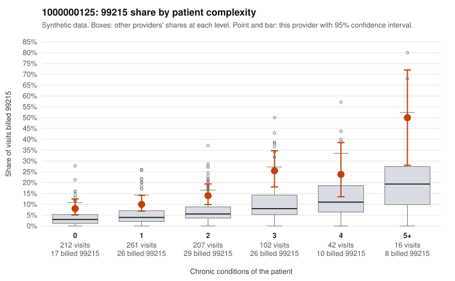

# 1000000125: 1000000125: documented 99215 claims mostly support the level billed (10% below)

**Leaning (advisory):** Pattern consistent with a high-acuity panel

## Why

1000000125 billed 99215 on 13.8% of 840 claims against an expected 5.0% given patient complexity (risk-adjusted score 4.82; plain z-score vs peers 1.35). 37% of this provider's 99215 claims were on patients with 0 or 1 chronic conditions. Records came back for 45 claims. Of 19 documented 99215 claims, 2 (10%) were documented below the billed level, against 42% for the comparison providers. Note checks on 45 returned notes (share showing each sign): problems 18%, late 9%, unsigned 0%, data 9%. No audit trail was received. 6 of 36 notes claiming moderate-or-higher data reviewed had no lab or test line on the claim. This pattern is consistent with a high-acuity panel. The sampled documentation supports the billed level. Examples: C0064801: billed 99215; documented MDM level high, minutes not recorded. C0064901: billed 99215; documented MDM level high, 48 minutes. C0065051: billed 99215; documented MDM level high, minutes not recorded. C0064851: billed 99215, patient aged 70 with 4 chronic condition(s) (obesity;depression;hypertension;osteoarthritis). C0064864: billed 99215, patient aged 92 with 5 chronic condition(s) (hyperlipidemia;hypertension;atrial fibrillation;heart failure;osteoarthritis).

## Evidence chart

## Cited claims

`C0064801`, `C0064901`, `C0065051`, `C0064851`, `C0064864`

## Suggested next steps

- Do not pursue recovery on this evidence: 45 charts came back and they support the level billed (2 of 19 documented 99215 claims below the billed level).
- Revisit if the 99215 share keeps rising against peers or a larger sample shows unsupported claims.

---
Citations checked: 5/5 valid. Synthetic data. The leaning is advisory; the flag comes from the statistical screen, and no clinical documentation is available beyond the sampled records-review facts shown in the packet.
