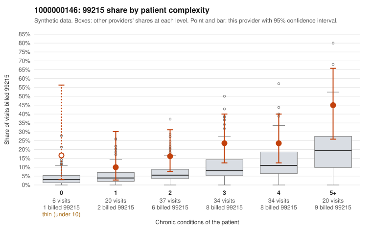

# 1000000146: 1000000146: documented 99215 claims mostly support the level billed (17% below)

**Leaning (advisory):** Pattern consistent with a high-acuity panel

## Why

1000000146 billed 99215 on 22.5% of 151 claims against an expected 8.0% given patient complexity (risk-adjusted score 2.65; plain z-score vs peers 2.99). 9% of this provider's 99215 claims were on patients with 0 or 1 chronic conditions. Records came back for 30 claims. Of 6 documented 99215 claims, 1 (17%) were documented below the billed level, against 42% for the comparison providers. Note checks on 30 returned notes (share showing each sign): problems 3%, late 3%, unsigned 0%, data 0%. No audit trail was received. 1 of 19 notes claiming moderate-or-higher data reviewed had no lab or test line on the claim. This pattern is consistent with a high-acuity panel. The sampled documentation supports the billed level. Examples: C0072737: billed 99215; documented MDM level high, 41 minutes. C0072740: billed 99215; documented MDM level high, 35 minutes. C0072759: billed 99215, patient aged 54 with 4 chronic condition(s) (hypothyroidism;type 2 diabetes;depression;COPD); documented MDM level high, 34 minutes. C0072756: billed 99215, patient aged 67 with 4 chronic condition(s) (type 2 diabetes;depression;hypertension;osteoarthritis).

## Evidence chart

## Cited claims

`C0072737`, `C0072740`, `C0072759`, `C0072756`

## Suggested next steps

- Do not pursue recovery on this evidence: 30 charts came back and they support the level billed (1 of 6 documented 99215 claims below the billed level).
- Revisit if the 99215 share keeps rising against peers or a larger sample shows unsupported claims.

---
Citations checked: 4/4 valid. Synthetic data. The leaning is advisory; the flag comes from the statistical screen, and no clinical documentation is available beyond the sampled records-review facts shown in the packet.
