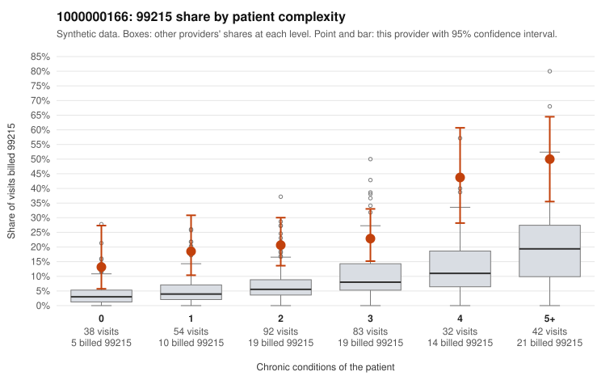

# 1000000166: 1000000166: too few returned records to judge

**Leaning (advisory):** Inconclusive

## Why

1000000166 billed 99215 on 25.8% of 341 claims against an expected 7.2% given patient complexity (risk-adjusted score 5.49; plain z-score vs peers 3.61). 17% of this provider's 99215 claims were on patients with 0 or 1 chronic conditions. Records came back for 45 claims. Of 20 documented 99215 claims, 2 (10%) were documented below the billed level, against 42% for the comparison providers. Note checks on 45 returned notes (share showing each sign): problems 11%, late 7%, unsigned 0%, data 2%. No audit trail was received. 6 of 36 notes claiming moderate-or-higher data reviewed had no lab or test line on the claim. The evidence does not support a call either way yet. Examples: C0079426: billed 99215; documented MDM level moderate, 35 minutes. C0079696: billed 99215; documented MDM level moderate, 33 minutes. C0079413: billed 99215, patient aged 46 with 1 chronic condition(s) (osteoarthritis). C0079418: billed 99215, patient aged 59 with 1 chronic condition(s) (hypothyroidism).

## Evidence chart

## Cited claims

`C0079426`, `C0079696`, `C0079413`, `C0079418`

## Suggested next steps

- 45 charts came back but do not settle it: request a targeted sample of 99215 charts, starting with C0079426, C0079696, C0079413.
- Re-check after the targeted charts arrive; do not call upcoding or a sicker panel on this evidence alone.

---
Citations checked: 4/4 valid. Synthetic data. The leaning is advisory; the flag comes from the statistical screen, and no clinical documentation is available beyond the sampled records-review facts shown in the packet.
