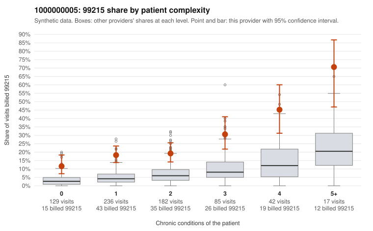

# 1000000005: 1000000005: too few returned records to judge

**Leaning (advisory):** Inconclusive

## Why

1000000005 billed 99215 on 21.7% of 691 claims against an expected 5.4% given patient complexity (risk-adjusted score 6.81; plain z-score vs peers 2.54). 39% of this provider's 99215 claims were on patients with 0 or 1 chronic conditions. Records came back for 30 claims. Of 8 documented 99215 claims, 0 (0%) were documented below the billed level, against 40% for the comparison providers. Note checks on 30 returned notes (share showing each sign): problems 27%, late 0%, unsigned 0%, data 0%. No audit trail was received. 0 of 21 notes claiming moderate-or-higher data reviewed had no lab or test line on the claim. The evidence does not support a call either way yet. Examples: C0002361: billed 99214; documented MDM level low, 21 minutes. C0002362: billed 99213; documented MDM level straightforward, minutes not recorded. C0002352: billed 99215, patient aged 52 with 0 chronic condition(s). C0002385: billed 99215, patient aged 35 with 1 chronic condition(s) (atrial fibrillation).

## Evidence chart

## Cited claims

`C0002361`, `C0002362`, `C0002352`, `C0002385`

## Suggested next steps

- 30 charts came back but do not settle it: request a targeted sample of 99215 charts, starting with C0002361, C0002362, C0002352.
- Re-check after the targeted charts arrive; do not call upcoding or a sicker panel on this evidence alone.

---
Citations checked: 4/4 valid. Synthetic data. The leaning is advisory; the flag comes from the statistical screen, and no clinical documentation is available beyond the sampled records-review facts shown in the packet.
