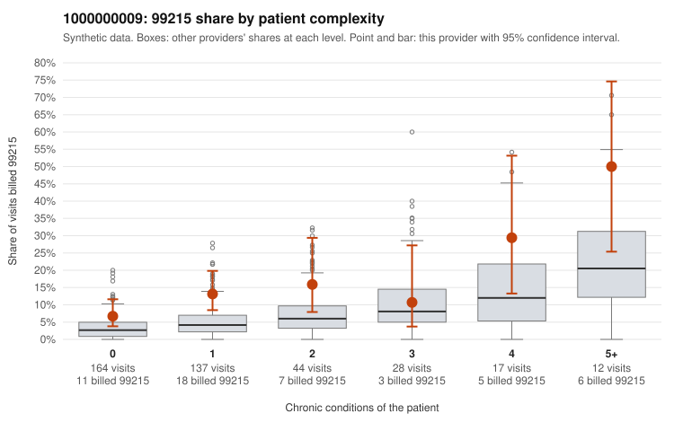

# 1000000009: 1000000009: documented 99215 claims mostly support the level billed (0% below)

**Leaning (advisory):** Pattern consistent with a high-acuity panel

## Why

1000000009 billed 99215 on 12.4% of 402 claims against an expected 4.6% given patient complexity (risk-adjusted score 2.56; plain z-score vs peers 0.91). 58% of this provider's 99215 claims were on patients with 0 or 1 chronic conditions. Records came back for 30 claims. Of 6 documented 99215 claims, 0 (0%) were documented below the billed level, against 40% for the comparison providers. Note checks on 30 returned notes (share showing each sign): problems 37%, late 7%, unsigned 0%, data 7%. No audit trail was received. 3 of 19 notes claiming moderate-or-higher data reviewed had no lab or test line on the claim. This pattern is consistent with a high-acuity panel. The sampled documentation supports the billed level. Examples: C0005587: billed 99215, patient aged 41 with 1 chronic condition(s) (hyperlipidemia); documented MDM level high, minutes not recorded. C0005878: billed 99215, patient aged 65 with 5 chronic condition(s) (type 2 diabetes;obesity;hyperlipidemia;hypertension;osteoarthritis); documented MDM level high, 54 minutes. C0005899: billed 99215, patient aged 22 with 1 chronic condition(s) (osteoarthritis); documented MDM level high, minutes not recorded. C0005610: billed 99215, patient aged 51 with 4 chronic condition(s) (obesity;hypertension;heart failure;asthma). C0005628: billed 99215, patient aged 73 with 5 chronic condition(s) (hypothyroidism;type 2 diabetes;obesity;depression;hypertension).

## Evidence chart

## Cited claims

`C0005587`, `C0005878`, `C0005899`, `C0005610`, `C0005628`

## Suggested next steps

- Do not pursue recovery on this evidence: 30 charts came back and they support the level billed (0 of 6 documented 99215 claims below the billed level).
- Revisit if the 99215 share keeps rising against peers or a larger sample shows unsupported claims.

---
Citations checked: 5/5 valid. Synthetic data. The leaning is advisory; the flag comes from the statistical screen, and no clinical documentation is available beyond the sampled records-review facts shown in the packet.
