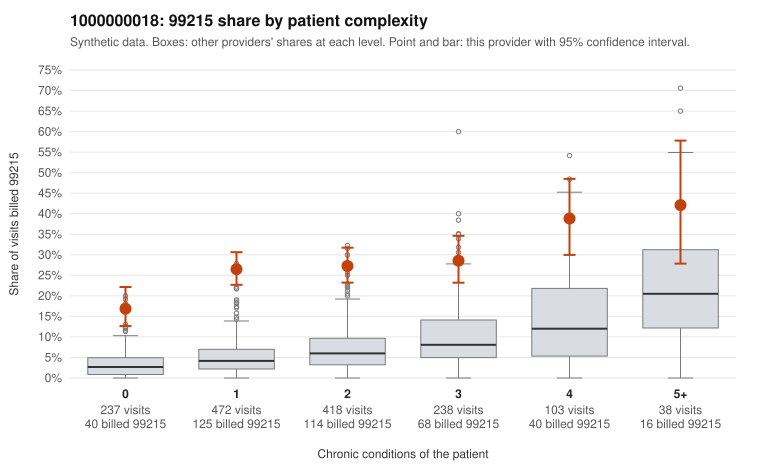

# 1000000018: 1000000018: too few returned records to judge

**Leaning (advisory):** Inconclusive

## Why

1000000018 billed 99215 on 26.8% of 1,506 claims against an expected 5.6% given patient complexity (risk-adjusted score 12.91; plain z-score vs peers 3.43). 41% of this provider's 99215 claims were on patients with 0 or 1 chronic conditions. Records came back for 45 claims. Of 18 documented 99215 claims, 0 (0%) were documented below the billed level, against 40% for the comparison providers. Note checks on 45 returned notes (share showing each sign): problems 13%, late 11%, unsigned 0%, data 9%. No audit trail was received. 4 of 33 notes claiming moderate-or-higher data reviewed had no lab or test line on the claim. The evidence does not support a call either way yet. Examples: C0009210: billed 99214; documented MDM level low, minutes not recorded. C0008458: billed 99215, patient aged 45 with 1 chronic condition(s) (depression). C0008465: billed 99215, patient aged 58 with 1 chronic condition(s) (obesity).

## Evidence chart

## Cited claims

`C0009210`, `C0008458`, `C0008465`

## Suggested next steps

- 45 charts came back but do not settle it: request a targeted sample of 99215 charts, starting with C0009210, C0008458, C0008465.
- Re-check after the targeted charts arrive; do not call upcoding or a sicker panel on this evidence alone.

---
Citations checked: 3/3 valid. Synthetic data. The leaning is advisory; the flag comes from the statistical screen, and no clinical documentation is available beyond the sampled records-review facts shown in the packet.
