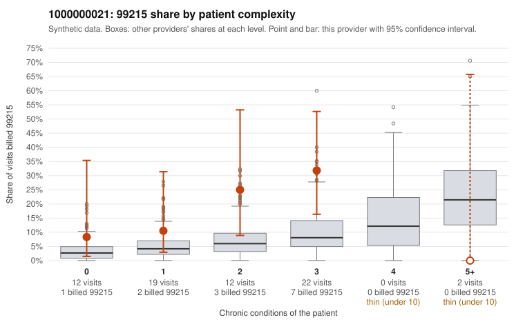

# 1000000021: 1000000021: too few returned records to judge

**Leaning (advisory):** Inconclusive

## Why

1000000021 billed 99215 on 19.4% of 67 claims against an expected 5.6% given patient complexity (risk-adjusted score 1.61; plain z-score vs peers 2.13). 23% of this provider's 99215 claims were on patients with 0 or 1 chronic conditions. Records came back for 30 claims. Of 6 documented 99215 claims, 1 (17%) were documented below the billed level, against 40% for the comparison providers. Note checks on 30 returned notes (share showing each sign): problems 23%, late 3%, unsigned 0%, data 3%. No audit trail was received. 5 of 23 notes claiming moderate-or-higher data reviewed had no lab or test line on the claim. The evidence does not support a call either way yet. Examples: C0010143: billed 99215, patient aged 57 with 1 chronic condition(s) (type 2 diabetes); documented MDM level moderate, 28 minutes. C0010117: billed 99215, patient aged 44 with 1 chronic condition(s) (asthma). C0010134: billed 99215, patient aged 43 with 0 chronic condition(s); documented MDM level high, 43 minutes.

## Evidence chart

## Cited claims

`C0010143`, `C0010117`, `C0010134`

## Suggested next steps

- 30 charts came back but do not settle it: request a targeted sample of 99215 charts, starting with C0010143, C0010117, C0010134.
- Re-check after the targeted charts arrive; do not call upcoding or a sicker panel on this evidence alone.

---
Citations checked: 3/3 valid. Synthetic data. The leaning is advisory; the flag comes from the statistical screen, and no clinical documentation is available beyond the sampled records-review facts shown in the packet.
