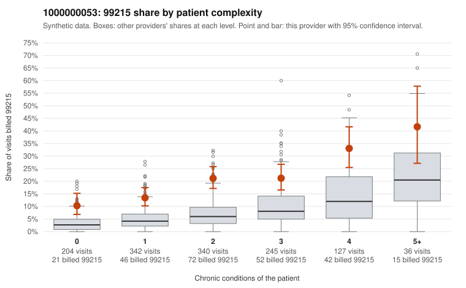

# 1000000053: 1000000053: 1 of 20 documented 99215 claims (5%) are documented below the billed level

**Leaning (advisory):** Pattern consistent with upcoding

## Why

1000000053 billed 99215 on 19.2% of 1,294 claims against an expected 5.9% given patient complexity (risk-adjusted score 7.21; plain z-score vs peers 2.09). 27% of this provider's 99215 claims were on patients with 0 or 1 chronic conditions. Records came back for 45 claims. Of 20 documented 99215 claims, 1 (5%) were documented below the billed level, against 40% for the comparison providers. Note checks on 45 returned notes (share showing each sign): problems 20%, late 20%, unsigned 0%, data 20%, bulk created 11%, paste heavy 16%. 10 of 34 notes claiming moderate-or-higher data reviewed had no lab or test line on the claim. This pattern is consistent with upcoding. It is a reason to review the records, not a finding. Examples: C0028394: billed 99215, patient aged 34 with 1 chronic condition(s) (hypertension); documented MDM level moderate, minutes not recorded. C0027695: billed 99215, patient aged 43 with 0 chronic condition(s). C0027697: billed 99215, patient aged 37 with 0 chronic condition(s). C0027786: billed 99215, patient aged 90 with 0 chronic condition(s).

## Evidence chart

## Cited claims

`C0028394`, `C0027695`, `C0027697`, `C0027786`

## Suggested next steps

- Request the full charts for C0028394, C0027695, C0027697 and have a certified coder re-score each against the current E/M rules (medical decision making or total time).
- If the re-scoring confirms the pattern, review the random sample in the recovery packet's sampling plan before any overpayment estimate; do not extrapolate from a targeted sample.
- Look at the notes themselves: 20% address fewer problems than their level implies and 20% were signed late; request the audit trail for C0028394, C0027695, C0027697.

---
Citations checked: 4/4 valid. Synthetic data. The leaning is advisory; the flag comes from the statistical screen, and no clinical documentation is available beyond the sampled records-review facts shown in the packet.
