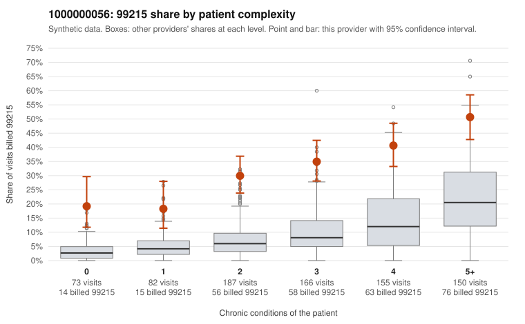

# 1000000056: 1000000056: 7 of 9 documented 99215 claims (78%) are documented below the billed level

**Leaning (advisory):** Pattern consistent with upcoding

## Why

1000000056 billed 99215 on 34.7% of 813 claims against an expected 8.6% given patient complexity (risk-adjusted score 9.55; plain z-score vs peers 4.82). 10% of this provider's 99215 claims were on patients with 0 or 1 chronic conditions. Records came back for 30 claims. Of 9 documented 99215 claims, 7 (78%) were documented below the billed level, against 40% for the comparison providers. Note checks on 30 returned notes (share showing each sign): problems 3%, late 3%, unsigned 0%, data 0%. No audit trail was received. 2 of 25 notes claiming moderate-or-higher data reviewed had no lab or test line on the claim. This pattern is consistent with upcoding. It is a reason to review the records, not a finding. Examples: C0030532: billed 99215, patient aged 57 with 1 chronic condition(s) (asthma); documented MDM level moderate, minutes not recorded. C0030540: billed 99215; documented MDM level moderate, minutes not recorded. C0030687: billed 99215, patient aged 65 with 5 chronic condition(s) (hypothyroidism;type 2 diabetes;hypertension;asthma;osteoarthritis); documented MDM level moderate, minutes not recorded. C0030357: billed 99215, patient aged 53 with 1 chronic condition(s) (COPD). C0030362: billed 99215, patient aged 64 with 1 chronic condition(s) (hypertension). C0030419: billed 99215, patient aged 61 with 1 chronic condition(s) (hypothyroidism).

## Evidence chart

## Cited claims

`C0030532`, `C0030540`, `C0030687`, `C0030357`, `C0030362`, `C0030419`

## Suggested next steps

- Request the full charts for C0030532, C0030540, C0030687 and have a certified coder re-score each against the current E/M rules (medical decision making or total time).
- If the re-scoring confirms the pattern, review the random sample in the recovery packet's sampling plan before any overpayment estimate; do not extrapolate from a targeted sample.
- Look at the notes themselves: 3% address fewer problems than their level implies and 3% were signed late; request the audit trail for C0030532, C0030540, C0030687.

---
Citations checked: 6/6 valid. Synthetic data. The leaning is advisory; the flag comes from the statistical screen, and no clinical documentation is available beyond the sampled records-review facts shown in the packet.
