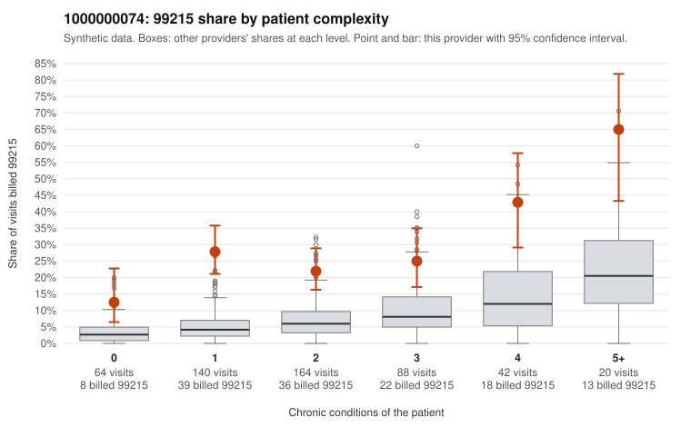

# 1000000074: 1000000074: too few returned records to judge

**Leaning (advisory):** Inconclusive

## Why

1000000074 billed 99215 on 26.3% of 518 claims against an expected 6.0% given patient complexity (risk-adjusted score 6.93; plain z-score vs peers 3.34). 35% of this provider's 99215 claims were on patients with 0 or 1 chronic conditions. Records came back for 30 claims. Of 9 documented 99215 claims, 1 (11%) were documented below the billed level, against 40% for the comparison providers. Note checks on 30 returned notes (share showing each sign): problems 23%, late 0%, unsigned 0%, data 3%. No audit trail was received. 1 of 25 notes claiming moderate-or-higher data reviewed had no lab or test line on the claim. The evidence does not support a call either way yet. Examples: C0041736: billed 99215; documented MDM level moderate, minutes not recorded. C0041728: billed 99215, patient aged 46 with 1 chronic condition(s) (hypertension). C0041747: billed 99215, patient aged 29 with 1 chronic condition(s) (chronic kidney disease).

## Evidence chart

## Cited claims

`C0041736`, `C0041728`, `C0041747`

## Suggested next steps

- 30 charts came back but do not settle it: request a targeted sample of 99215 charts, starting with C0041736, C0041728, C0041747.
- Re-check after the targeted charts arrive; do not call upcoding or a sicker panel on this evidence alone.

---
Citations checked: 3/3 valid. Synthetic data. The leaning is advisory; the flag comes from the statistical screen, and no clinical documentation is available beyond the sampled records-review facts shown in the packet.
