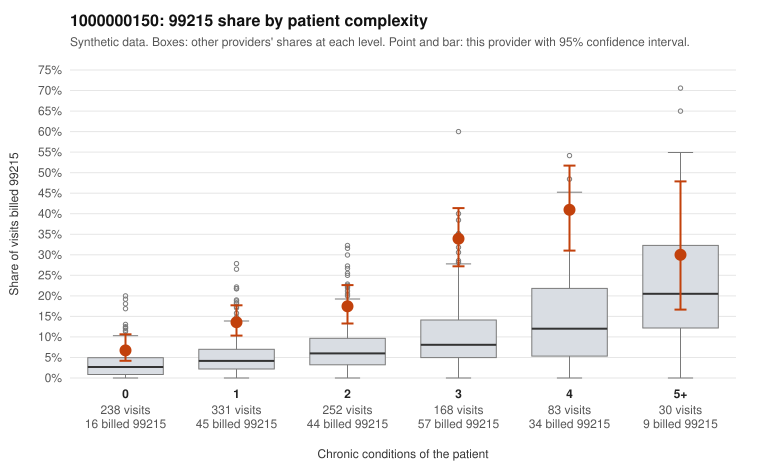

# 1000000150: 1000000150: too few returned records to judge

**Leaning (advisory):** Inconclusive

## Why

1000000150 billed 99215 on 18.6% of 1,102 claims against an expected 5.5% given patient complexity (risk-adjusted score 6.80; plain z-score vs peers 1.99). 30% of this provider's 99215 claims were on patients with 0 or 1 chronic conditions. Records came back for 45 claims. Of 20 documented 99215 claims, 5 (25%) were documented below the billed level, against 40% for the comparison providers. Note checks on 45 returned notes (share showing each sign): problems 20%, late 2%, unsigned 0%, data 2%. No audit trail was received. 1 of 35 notes claiming moderate-or-higher data reviewed had no lab or test line on the claim. The evidence does not support a call either way yet. Examples: C0075908: billed 99215, patient aged 85 with 1 chronic condition(s) (type 2 diabetes); documented MDM level moderate, 32 minutes. C0076525: billed 99215; documented MDM level moderate, 38 minutes. C0075800: billed 99215, patient aged 57 with 1 chronic condition(s) (hypertension). C0075895: billed 99215, patient aged 64 with 1 chronic condition(s) (hypertension).

## Evidence chart

## Cited claims

`C0075908`, `C0076525`, `C0075800`, `C0075895`

## Suggested next steps

- 45 charts came back but do not settle it: request a targeted sample of 99215 charts, starting with C0075908, C0076525, C0075800.
- Re-check after the targeted charts arrive; do not call upcoding or a sicker panel on this evidence alone.

---
Citations checked: 4/4 valid. Synthetic data. The leaning is advisory; the flag comes from the statistical screen, and no clinical documentation is available beyond the sampled records-review facts shown in the packet.
