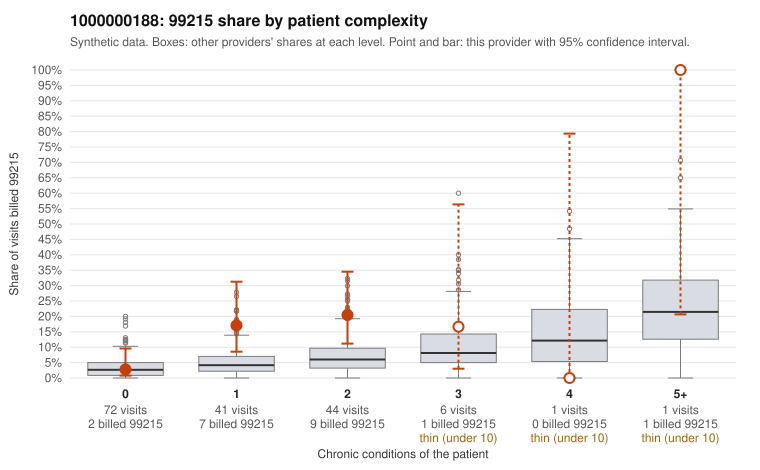

# 1000000188: 1000000188: too few returned records to judge

**Leaning (advisory):** Inconclusive

## Why

1000000188 billed 99215 on 12.1% of 165 claims against an expected 4.2% given patient complexity (risk-adjusted score 1.68; plain z-score vs peers 0.85). 45% of this provider's 99215 claims were on patients with 0 or 1 chronic conditions. Records came back for 30 claims. Of 4 documented 99215 claims, 2 (50%) were documented below the billed level, against 40% for the comparison providers. Note checks on 30 returned notes (share showing each sign): problems 27%, late 0%, unsigned 0%, data 0%. No audit trail was received. 0 of 21 notes claiming moderate-or-higher data reviewed had no lab or test line on the claim. The evidence does not support a call either way yet. Examples: C0096236: billed 99215, patient aged 32 with 1 chronic condition(s) (hyperlipidemia); documented MDM level moderate, 35 minutes. C0096343: billed 99215; documented MDM level moderate, 34 minutes. C0096234: billed 99215, patient aged 70 with 0 chronic condition(s).

## Evidence chart

## Cited claims

`C0096236`, `C0096343`, `C0096234`

## Suggested next steps

- 30 charts came back but do not settle it: request a targeted sample of 99215 charts, starting with C0096236, C0096343, C0096234.
- Re-check after the targeted charts arrive; do not call upcoding or a sicker panel on this evidence alone.

---
Citations checked: 3/3 valid. Synthetic data. The leaning is advisory; the flag comes from the statistical screen, and no clinical documentation is available beyond the sampled records-review facts shown in the packet.
