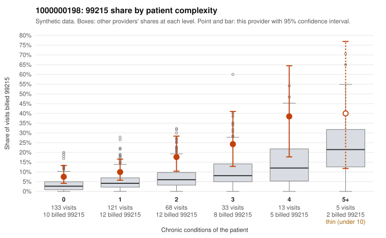

# 1000000198: 1000000198: too few returned records to judge

**Leaning (advisory):** Inconclusive

## Why

1000000198 billed 99215 on 13.1% of 373 claims against an expected 4.6% given patient complexity (risk-adjusted score 2.70; plain z-score vs peers 1.03). 45% of this provider's 99215 claims were on patients with 0 or 1 chronic conditions. Records came back for 30 claims. No documented 99215 claims came back. Note checks on 30 returned notes (share showing each sign): problems 30%, late 7%, unsigned 0%, data 7%. No audit trail was received. 2 of 26 notes claiming moderate-or-higher data reviewed had no lab or test line on the claim. The evidence does not support a call either way yet. Examples: C0102945: billed 99215, patient aged 70 with 1 chronic condition(s) (obesity). C0102947: billed 99215, patient aged 30 with 0 chronic condition(s).

## Evidence chart

## Cited claims

`C0102945`, `C0102947`

## Suggested next steps

- 30 charts came back but do not settle it: request a targeted sample of 99215 charts, starting with C0102945, C0102947.
- Re-check after the targeted charts arrive; do not call upcoding or a sicker panel on this evidence alone.

---
Citations checked: 2/2 valid. Synthetic data. The leaning is advisory; the flag comes from the statistical screen, and no clinical documentation is available beyond the sampled records-review facts shown in the packet.
