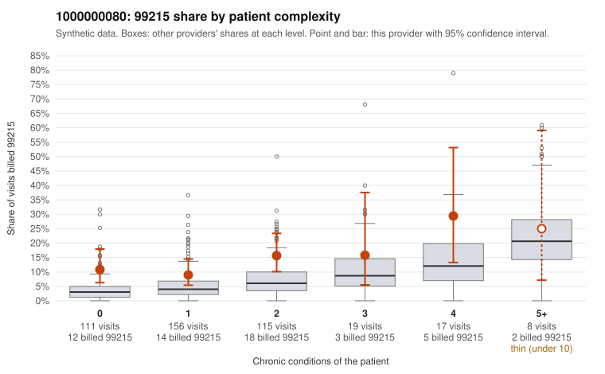

# 1000000080: 1000000080: too few returned records to judge

**Leaning (advisory):** Inconclusive

## Why

1000000080 billed 99215 on 12.7% of 426 claims against an expected 4.8% given patient complexity (risk-adjusted score 2.85; plain z-score vs peers 0.84). 48% of this provider's 99215 claims were on patients with 0 or 1 chronic conditions. Records came back for 45 claims. Of 17 documented 99215 claims, 7 (41%) were documented below the billed level, against 21% for the comparison providers. Note checks on 45 returned notes (share showing each sign): problems 40%, late 9%, unsigned 0%, data 2%, bulk created 0%, paste heavy 0%. 1 of 33 notes claiming moderate-or-higher data reviewed had no lab or test line on the claim. The evidence does not support a call either way yet. Examples: C0043286: billed 99215, patient aged 65 with 1 chronic condition(s) (hypertension); documented MDM level moderate, minutes not recorded. C0043369: billed 99215, patient aged 60 with 5 chronic condition(s) (hypothyroidism;type 2 diabetes;obesity;hypertension;osteoarthritis); documented MDM level moderate, minutes not recorded. C0043174: billed 99215, patient aged 50 with 1 chronic condition(s) (osteoarthritis). C0043189: billed 99215, patient aged 44 with 0 chronic condition(s).

## Evidence chart

## Cited claims

`C0043286`, `C0043369`, `C0043174`, `C0043189`

## Suggested next steps

- 45 charts came back but do not settle it: request a targeted sample of 99215 charts, starting with C0043286, C0043369, C0043174.
- Re-check after the targeted charts arrive; do not call upcoding or a sicker panel on this evidence alone.

---
Citations checked: 4/4 valid. Synthetic data. The leaning is advisory; the flag comes from the statistical screen, and no clinical documentation is available beyond the sampled records-review facts shown in the packet.
