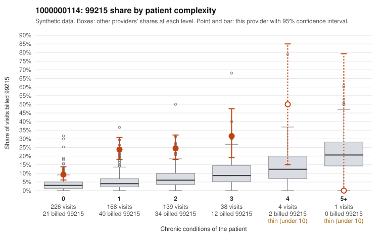

# 1000000114: 1000000114: too few returned records to judge

**Leaning (advisory):** Inconclusive

## Why

1000000114 billed 99215 on 18.9% of 576 claims against an expected 4.2% given patient complexity (risk-adjusted score 6.81; plain z-score vs peers 1.84). 56% of this provider's 99215 claims were on patients with 0 or 1 chronic conditions. Records came back for 30 claims. Of 8 documented 99215 claims, 0 (0%) were documented below the billed level, against 21% for the comparison providers. Note checks on 30 returned notes (share showing each sign): problems 37%, late 7%, unsigned 0%, data 0%, bulk created 0%, paste heavy 0%. 0 of 21 notes claiming moderate-or-higher data reviewed had no lab or test line on the claim. The evidence does not support a call either way yet. Examples: C0057804: billed 99215, patient aged 49 with 1 chronic condition(s) (COPD). C0057874: billed 99215, patient aged 58 with 1 chronic condition(s) (depression).

## Evidence chart

## Cited claims

`C0057804`, `C0057874`

## Suggested next steps

- 30 charts came back but do not settle it: request a targeted sample of 99215 charts, starting with C0057804, C0057874.
- Re-check after the targeted charts arrive; do not call upcoding or a sicker panel on this evidence alone.

---
Citations checked: 2/2 valid. Synthetic data. The leaning is advisory; the flag comes from the statistical screen, and no clinical documentation is available beyond the sampled records-review facts shown in the packet.
