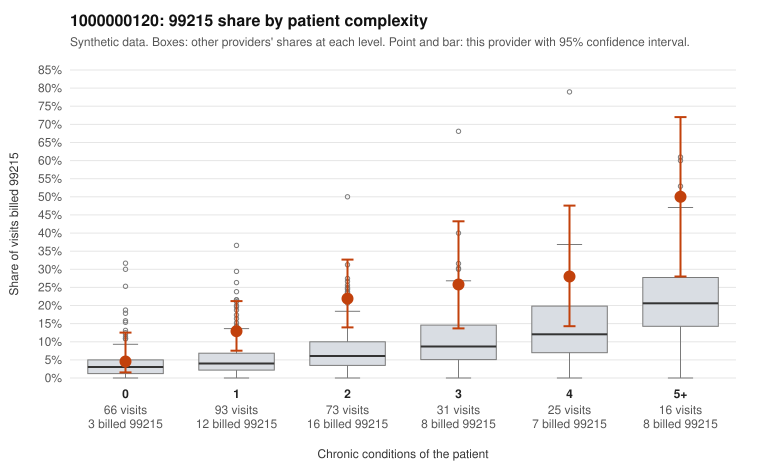

# 1000000120: 1000000120: too few returned records to judge

**Leaning (advisory):** Inconclusive

## Why

1000000120 billed 99215 on 17.8% of 304 claims against an expected 5.8% given patient complexity (risk-adjusted score 3.36; plain z-score vs peers 1.65). 28% of this provider's 99215 claims were on patients with 0 or 1 chronic conditions. Records came back for 30 claims. Of 5 documented 99215 claims, 3 (60%) were documented below the billed level, against 21% for the comparison providers. Note checks on 30 returned notes (share showing each sign): problems 20%, late 7%, unsigned 0%, data 0%. No audit trail was received. 0 of 14 notes claiming moderate-or-higher data reviewed had no lab or test line on the claim. The evidence does not support a call either way yet. Examples: C0060731: billed 99215; documented MDM level moderate, 36 minutes. C0060743: billed 99215, patient aged 48 with 1 chronic condition(s) (heart failure); documented MDM level moderate, 37 minutes. C0060635: billed 99215, patient aged 51 with 1 chronic condition(s) (osteoarthritis). C0060645: billed 99215, patient aged 46 with 0 chronic condition(s); documented MDM level high, 41 minutes.

## Evidence chart

## Cited claims

`C0060731`, `C0060743`, `C0060635`, `C0060645`

## Suggested next steps

- 30 charts came back but do not settle it: request a targeted sample of 99215 charts, starting with C0060731, C0060743, C0060635.
- Re-check after the targeted charts arrive; do not call upcoding or a sicker panel on this evidence alone.

---
Citations checked: 4/4 valid. Synthetic data. The leaning is advisory; the flag comes from the statistical screen, and no clinical documentation is available beyond the sampled records-review facts shown in the packet.
