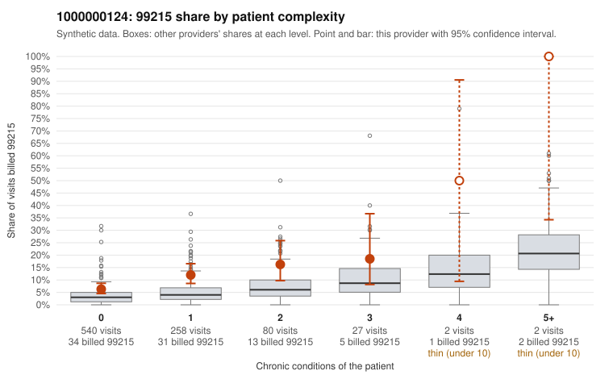

# 1000000124: 1000000124: too few returned records to judge

**Leaning (advisory):** Inconclusive

## Why

1000000124 billed 99215 on 9.5% of 909 claims against an expected 3.5% given patient complexity (risk-adjusted score 3.67; plain z-score vs peers 0.33). 76% of this provider's 99215 claims were on patients with 0 or 1 chronic conditions. Records came back for 45 claims. Of 17 documented 99215 claims, 4 (24%) were documented below the billed level, against 21% for the comparison providers. Note checks on 45 returned notes (share showing each sign): problems 47%, late 11%, unsigned 0%, data 11%, bulk created 0%, paste heavy 0%. 5 of 30 notes claiming moderate-or-higher data reviewed had no lab or test line on the claim. The evidence does not support a call either way yet. Examples: C0062784: billed 99215; documented MDM level moderate, minutes not recorded. C0062984: billed 99215; documented MDM level low, minutes not recorded. C0062600: billed 99215, patient aged 68 with 1 chronic condition(s) (osteoarthritis). C0062612: billed 99215, patient aged 49 with 0 chronic condition(s).

## Evidence chart

## Cited claims

`C0062784`, `C0062984`, `C0062600`, `C0062612`

## Suggested next steps

- 45 charts came back but do not settle it: request a targeted sample of 99215 charts, starting with C0062784, C0062984, C0062600.
- Re-check after the targeted charts arrive; do not call upcoding or a sicker panel on this evidence alone.

---
Citations checked: 4/4 valid. Synthetic data. The leaning is advisory; the flag comes from the statistical screen, and no clinical documentation is available beyond the sampled records-review facts shown in the packet.
