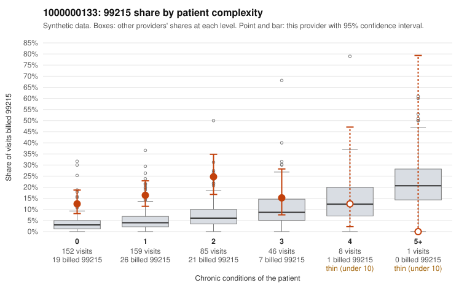

# 1000000133: 1000000133: 0 of 6 documented 99215 claims (0%) are documented below the billed level

**Leaning (advisory):** Pattern consistent with upcoding

## Why

1000000133 billed 99215 on 16.4% of 451 claims against an expected 4.4% given patient complexity (risk-adjusted score 4.75; plain z-score vs peers 1.44). 61% of this provider's 99215 claims were on patients with 0 or 1 chronic conditions. Records came back for 30 claims. Of 6 documented 99215 claims, 0 (0%) were documented below the billed level, against 21% for the comparison providers. Note checks on 30 returned notes (share showing each sign): problems 27%, late 27%, unsigned 0%, data 27%. No audit trail was received. 9 of 22 notes claiming moderate-or-higher data reviewed had no lab or test line on the claim. This pattern is consistent with upcoding. It is a reason to review the records, not a finding. Examples: C0067330: billed 99214; documented MDM level low, minutes not recorded. C0067616: billed 99214; documented MDM level low, minutes not recorded. C0067248: billed 99215, patient aged 18 with 0 chronic condition(s). C0067257: billed 99215, patient aged 47 with 0 chronic condition(s). C0067271: billed 99215, patient aged 58 with 0 chronic condition(s).

## Evidence chart

## Cited claims

`C0067330`, `C0067616`, `C0067248`, `C0067257`, `C0067271`

## Suggested next steps

- Request the full charts for C0067330, C0067616, C0067248 and have a certified coder re-score each against the current E/M rules (medical decision making or total time).
- If the re-scoring confirms the pattern, review the random sample in the recovery packet's sampling plan before any overpayment estimate; do not extrapolate from a targeted sample.
- Look at the notes themselves: 27% address fewer problems than their level implies and 27% were signed late; request the audit trail for C0067330, C0067616, C0067248.

---
Citations checked: 5/5 valid. Synthetic data. The leaning is advisory; the flag comes from the statistical screen, and no clinical documentation is available beyond the sampled records-review facts shown in the packet.
