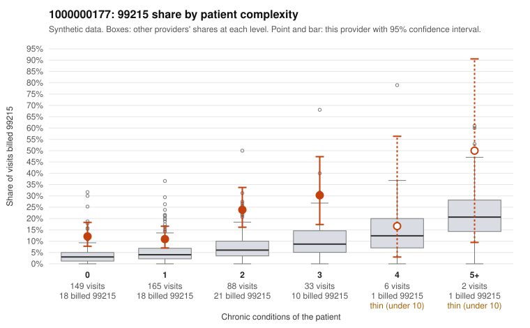

# 1000000177: 1000000177: too few returned records to judge

**Leaning (advisory):** Inconclusive

## Why

1000000177 billed 99215 on 15.6% of 443 claims against an expected 4.3% given patient complexity (risk-adjusted score 4.45; plain z-score vs peers 1.30). 52% of this provider's 99215 claims were on patients with 0 or 1 chronic conditions. Records came back for 44 claims. Of 18 documented 99215 claims, 1 (6%) were documented below the billed level, against 21% for the comparison providers. Note checks on 44 returned notes (share showing each sign): problems 32%, late 9%, unsigned 0%, data 9%. No audit trail was received. 5 of 30 notes claiming moderate-or-higher data reviewed had no lab or test line on the claim. The evidence does not support a call either way yet. Examples: C0091225: billed 99215, patient aged 36 with 1 chronic condition(s) (obesity); documented MDM level moderate, minutes not recorded. C0091191: billed 99215, patient aged 59 with 1 chronic condition(s) (obesity). C0091205: billed 99215, patient aged 66 with 1 chronic condition(s) (type 2 diabetes).

## Evidence chart

## Cited claims

`C0091225`, `C0091191`, `C0091205`

## Suggested next steps

- 44 charts came back but do not settle it: request a targeted sample of 99215 charts, starting with C0091225, C0091191, C0091205.
- Re-check after the targeted charts arrive; do not call upcoding or a sicker panel on this evidence alone.

---
Citations checked: 3/3 valid. Synthetic data. The leaning is advisory; the flag comes from the statistical screen, and no clinical documentation is available beyond the sampled records-review facts shown in the packet.
