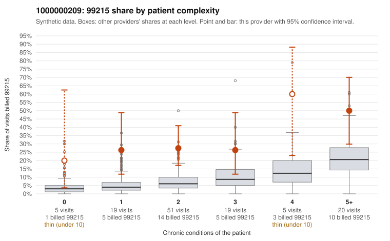

# 1000000209: 1000000209: too few returned records to judge

**Leaning (advisory):** Inconclusive

## Why

1000000209 billed 99215 on 31.9% of 119 claims against an expected 8.1% given patient complexity (risk-adjusted score 3.64; plain z-score vs peers 3.90). 16% of this provider's 99215 claims were on patients with 0 or 1 chronic conditions. Records came back for 29 claims. Of 10 documented 99215 claims, 2 (20%) were documented below the billed level, against 21% for the comparison providers. Note checks on 29 returned notes (share showing each sign): problems 7%, late 7%, unsigned 0%, data 3%. No audit trail was received. 2 of 23 notes claiming moderate-or-higher data reviewed had no lab or test line on the claim. The evidence does not support a call either way yet. Examples: C0106787: billed 99215, patient aged 96 with 5 chronic condition(s) (hyperlipidemia;depression;heart failure;COPD;osteoarthritis); documented MDM level moderate, minutes not recorded. C0106806: billed 99215, patient aged 82 with 0 chronic condition(s); documented MDM level moderate, 36 minutes. C0106740: billed 99215, patient aged 65 with 1 chronic condition(s) (osteoarthritis). C0106745: billed 99215, patient aged 60 with 1 chronic condition(s) (hypothyroidism).

## Evidence chart

## Cited claims

`C0106787`, `C0106806`, `C0106740`, `C0106745`

## Suggested next steps

- 29 charts came back but do not settle it: request a targeted sample of 99215 charts, starting with C0106787, C0106806, C0106740.
- Re-check after the targeted charts arrive; do not call upcoding or a sicker panel on this evidence alone.

---
Citations checked: 4/4 valid. Synthetic data. The leaning is advisory; the flag comes from the statistical screen, and no clinical documentation is available beyond the sampled records-review facts shown in the packet.
