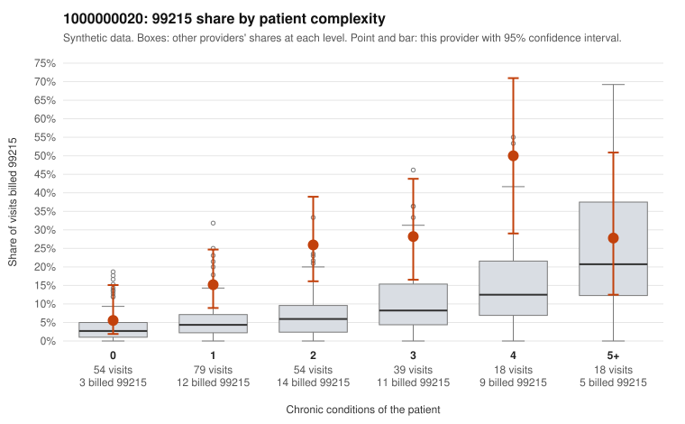

# 1000000020: 1000000020: too few returned records to judge

**Leaning (advisory):** Inconclusive

## Why

1000000020 billed 99215 on 20.6% of 262 claims against an expected 6.2% given patient complexity (risk-adjusted score 3.75; plain z-score vs peers 2.48). 28% of this provider's 99215 claims were on patients with 0 or 1 chronic conditions. Records came back for 30 claims. Of 6 documented 99215 claims, 0 (0%) were documented below the billed level, against 20% for the comparison providers. Note checks on 30 returned notes (share showing each sign): problems 27%, late 7%, unsigned 0%, data 0%. No audit trail was received. 3 of 23 notes claiming moderate-or-higher data reviewed had no lab or test line on the claim. The evidence does not support a call either way yet. Examples: C0007605: billed 99215, patient aged 79 with 0 chronic condition(s). C0007612: billed 99215, patient aged 49 with 0 chronic condition(s).

## Evidence chart

## Cited claims

`C0007605`, `C0007612`

## Suggested next steps

- 30 charts came back but do not settle it: request a targeted sample of 99215 charts, starting with C0007605, C0007612.
- Re-check after the targeted charts arrive; do not call upcoding or a sicker panel on this evidence alone.

---
Citations checked: 2/2 valid. Synthetic data. The leaning is advisory; the flag comes from the statistical screen, and no clinical documentation is available beyond the sampled records-review facts shown in the packet.
