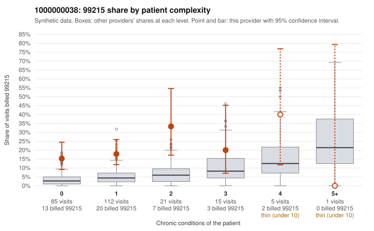

# 1000000038: 1000000038: 0 of 6 documented 99215 claims (0%) are documented below the billed level

**Leaning (advisory):** Pattern consistent with upcoding

## Why

1000000038 billed 99215 on 18.8% of 239 claims against an expected 4.1% given patient complexity (risk-adjusted score 4.42; plain z-score vs peers 2.16). 73% of this provider's 99215 claims were on patients with 0 or 1 chronic conditions. Records came back for 30 claims. Of 6 documented 99215 claims, 0 (0%) were documented below the billed level, against 20% for the comparison providers. Note checks on 30 returned notes (share showing each sign): problems 33%, late 13%, unsigned 0%, data 3%, bulk created 10%, paste heavy 10%. 3 of 21 notes claiming moderate-or-higher data reviewed had no lab or test line on the claim. This pattern is consistent with upcoding. It is a reason to review the records, not a finding. Examples: C0014821: billed 99214; documented MDM level low, minutes not recorded. C0014869: billed 99213; documented MDM level straightforward, minutes not recorded. C0014751: billed 99215, patient aged 46 with 0 chronic condition(s). C0014758: billed 99215, patient aged 59 with 1 chronic condition(s) (heart failure). C0014774: billed 99215, patient aged 44 with 0 chronic condition(s).

## Evidence chart

## Cited claims

`C0014821`, `C0014869`, `C0014751`, `C0014758`, `C0014774`

## Suggested next steps

- Request the full charts for C0014821, C0014869, C0014751 and have a certified coder re-score each against the current E/M rules (medical decision making or total time).
- If the re-scoring confirms the pattern, review the random sample in the recovery packet's sampling plan before any overpayment estimate; do not extrapolate from a targeted sample.
- Look at the notes themselves: 33% address fewer problems than their level implies and 13% were signed late; request the audit trail for C0014821, C0014869, C0014751.

---
Citations checked: 5/5 valid. Synthetic data. The leaning is advisory; the flag comes from the statistical screen, and no clinical documentation is available beyond the sampled records-review facts shown in the packet.
