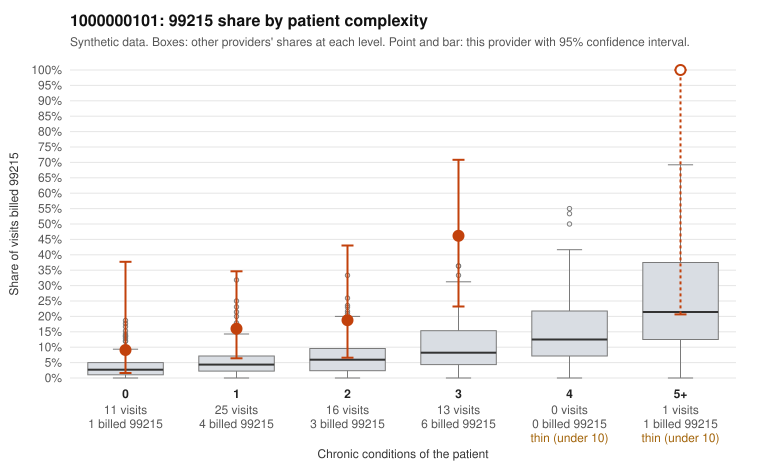

# 1000000101: 1000000101: too few returned records to judge

**Leaning (advisory):** Inconclusive

## Why

1000000101 billed 99215 on 22.7% of 66 claims against an expected 5.2% given patient complexity (risk-adjusted score 2.46; plain z-score vs peers 2.85). 33% of this provider's 99215 claims were on patients with 0 or 1 chronic conditions. Records came back for 30 claims. Of 8 documented 99215 claims, 1 (12%) were documented below the billed level, against 20% for the comparison providers. Note checks on 30 returned notes (share showing each sign): problems 20%, late 10%, unsigned 0%, data 7%. No audit trail was received. 3 of 21 notes claiming moderate-or-higher data reviewed had no lab or test line on the claim. The evidence does not support a call either way yet. Examples: C0050399: billed 99215; documented MDM level moderate, 20 minutes. C0050358: billed 99215, patient aged 42 with 1 chronic condition(s) (hypothyroidism); documented MDM level high, 48 minutes. C0050368: billed 99215, patient aged 47 with 1 chronic condition(s) (osteoarthritis); documented MDM level high, 45 minutes.

## Evidence chart

## Cited claims

`C0050399`, `C0050358`, `C0050368`

## Suggested next steps

- 30 charts came back but do not settle it: request a targeted sample of 99215 charts, starting with C0050399, C0050358, C0050368.
- Re-check after the targeted charts arrive; do not call upcoding or a sicker panel on this evidence alone.

---
Citations checked: 3/3 valid. Synthetic data. The leaning is advisory; the flag comes from the statistical screen, and no clinical documentation is available beyond the sampled records-review facts shown in the packet.
