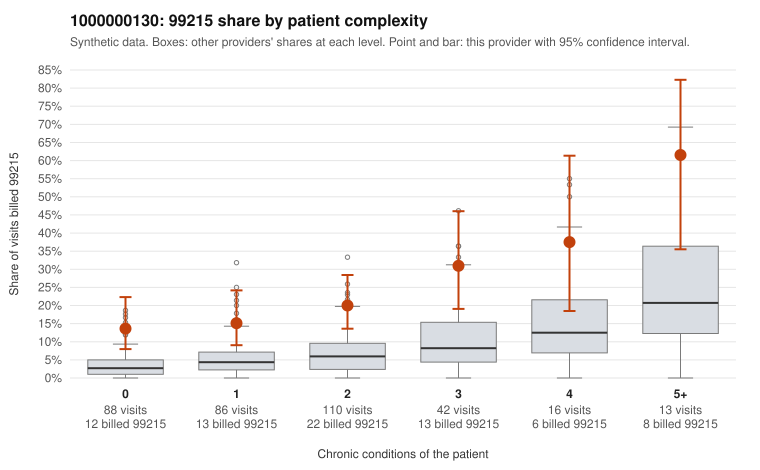

# 1000000130: 1000000130: too few returned records to judge

**Leaning (advisory):** Inconclusive

## Why

1000000130 billed 99215 on 20.8% of 355 claims against an expected 5.6% given patient complexity (risk-adjusted score 4.87; plain z-score vs peers 2.52). 34% of this provider's 99215 claims were on patients with 0 or 1 chronic conditions. Records came back for 27 claims. Of 8 documented 99215 claims, 3 (38%) were documented below the billed level, against 20% for the comparison providers. Note checks on 27 returned notes (share showing each sign): problems 30%, late 11%, unsigned 0%, data 0%. No audit trail was received. 2 of 22 notes claiming moderate-or-higher data reviewed had no lab or test line on the claim. The evidence does not support a call either way yet. Examples: C0064899: billed 99215; documented MDM level moderate, minutes not recorded. C0065075: billed 99215; documented MDM level moderate, 37 minutes. C0064778: billed 99215, patient aged 69 with 1 chronic condition(s) (type 2 diabetes). C0064791: billed 99215, patient aged 47 with 1 chronic condition(s) (obesity).

## Evidence chart

## Cited claims

`C0064899`, `C0065075`, `C0064778`, `C0064791`

## Suggested next steps

- 27 charts came back but do not settle it: request a targeted sample of 99215 charts, starting with C0064899, C0065075, C0064778.
- Re-check after the targeted charts arrive; do not call upcoding or a sicker panel on this evidence alone.

---
Citations checked: 4/4 valid. Synthetic data. The leaning is advisory; the flag comes from the statistical screen, and no clinical documentation is available beyond the sampled records-review facts shown in the packet.
