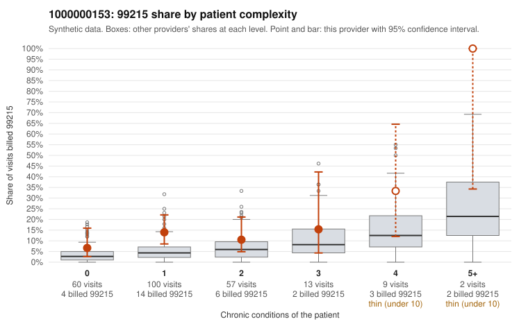

# 1000000153: Provider 1000000153 bills 99215 well above expectation, mostly on low-complexity patients, and the returned charts largely support the billed level, but note-integrity signals suggest the documentation itself may be templated or inflated.

**Leaning (advisory):** Inconclusive

## Why

1000000153 billed 99215 on 12.9% of 241 claims against an expected 4.7% given patient complexity (risk-adjusted score 2.31; plain z-score vs peers 1.09). 58% of this provider's 99215 claims were on patients with 0 or 1 chronic conditions. Records came back for 45 claims. Of 18 documented 99215 claims, 1 (6%) were documented below the billed level, against 20% for the comparison providers. Note checks on 45 returned notes (share showing each sign): problems 42%, late 27%, unsigned 0%, data 22%, bulk created 9%, paste heavy 16%. 12 of 33 notes claiming moderate-or-higher data reviewed had no lab or test line on the claim. Taken at face value, the billing pattern looks like upcoding: the excess 99215 share sits mainly in the 0–1 condition strata, on patients such as C0076431 (rash only) and C0076509 (follow-up code only). The records review cuts the other way, since documented 99215 claims were rarely unsupported, well under the comparison rate. That support is weakened by the note checks. More than half of returned notes are flagged as duplicates, a sizable share claim moderate-or-higher data review with no lab or test on the claim, and several supported 99215s are high-MDM, roughly 45-minute notes on single-condition patients (C0076526, a 19-year-old with hyperlipidemia; C0076546). This is consistent with cloned or inflated documentation, not proof of it, and with only about a fifth of claims documented the sample is limited. A reviewer should first compare the duplicate-flagged and bulk-created notes (e.g., C0076511) against the low-complexity 99215 claims, checking whether the MDM narrative and timed minutes reflect patient-specific content or a reused template. Examples: C0076548: billed 99215, patient aged 46 with 1 chronic condition(s) (depression); documented MDM level moderate, 35 minutes. C0076331: billed 99215, patient aged 78 with 1 chronic condition(s) (COPD). C0076335: billed 99215, patient aged 74 with 1 chronic condition(s) (type 2 diabetes).

## Evidence chart

## Cited claims

`C0076548`, `C0076331`, `C0076335`

## Suggested next steps

- 45 charts came back but do not settle it: request a targeted sample of 99215 charts, starting with C0076548, C0076331, C0076335.
- Re-check after the targeted charts arrive; do not call upcoding or a sicker panel on this evidence alone.

---
Citations checked: 3/3 valid. Synthetic data. The leaning is advisory; the flag comes from the statistical screen, and no clinical documentation is available beyond the sampled records-review facts shown in the packet.
