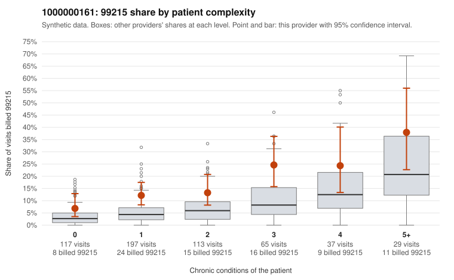

# 1000000161: Provider 1000000161 bills 99215 well above expectation in every complexity band, including on 0–1 condition patients, yet every documented 99215 is supported, though note-integrity signals raise the question of whether that documentation reflects the visits.

**Leaning (advisory):** Inconclusive

## Why

1000000161 billed 99215 on 14.9% of 558 claims against an expected 5.8% given patient complexity (risk-adjusted score 3.56; plain z-score vs peers 1.45). 39% of this provider's 99215 claims were on patients with 0 or 1 chronic conditions. Records came back for 44 claims. Of 20 documented 99215 claims, 0 (0%) were documented below the billed level, against 20% for the comparison providers. Note checks on 44 returned notes (share showing each sign): problems 30%, late 18%, unsigned 0%, data 23%, bulk created 7%, paste heavy 9%. 11 of 35 notes claiming moderate-or-higher data reviewed had no lab or test line on the claim. The billing side leans toward concern. The 99215 share runs above the all-provider share in every complexity stratum, and a large portion lands on patients with 0–1 chronic conditions, such as routine URI, hypertension or hypothyroidism visits (e.g., C0081020, C0081117, C0081138). That is not what a sicker panel alone would explain. Against this, none of the 20 documented 99215 claims fell below the billed level, versus the comparison rate, which on its face is consistent with legitimately complex visits. That reassurance is weakened by the notes: a high duplicate-note rate, repeated times, bulk-created and paste-heavy notes, and notes claiming moderate-or-higher data reviewed on claims with no lab or test line are a pattern consistent with cloned or inflated documentation, though none of this is proof. Records cover only a small fraction of claims, so a reviewer should first compare the documented 99215 notes side by side for templated text. Start with low-complexity cases documented as high MDM, such as C0081534, and with paste-heavy C0081205. The reviewer should also request charts targeted at the low-complexity 99215 claims. Examples: C0081376: billed 99214; documented MDM level low, minutes not recorded. C0080989: billed 99215, patient aged 54 with 1 chronic condition(s) (obesity). C0080994: billed 99215, patient aged 33 with 0 chronic condition(s).

## Evidence chart

## Cited claims

`C0081376`, `C0080989`, `C0080994`

## Suggested next steps

- 44 charts came back but do not settle it: request a targeted sample of 99215 charts, starting with C0081376, C0080989, C0080994.
- Re-check after the targeted charts arrive; do not call upcoding or a sicker panel on this evidence alone.

---
Citations checked: 3/3 valid. Synthetic data. The leaning is advisory; the flag comes from the statistical screen, and no clinical documentation is available beyond the sampled records-review facts shown in the packet.
